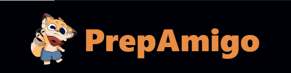
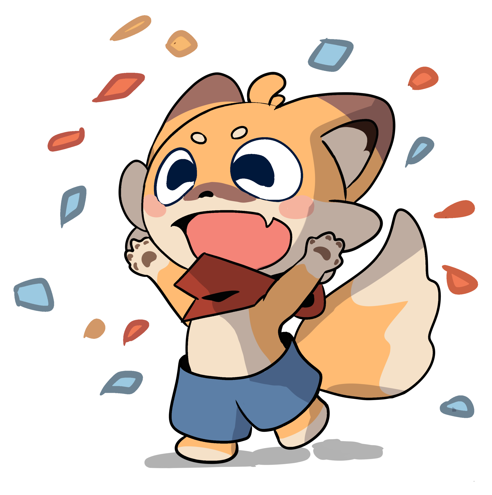
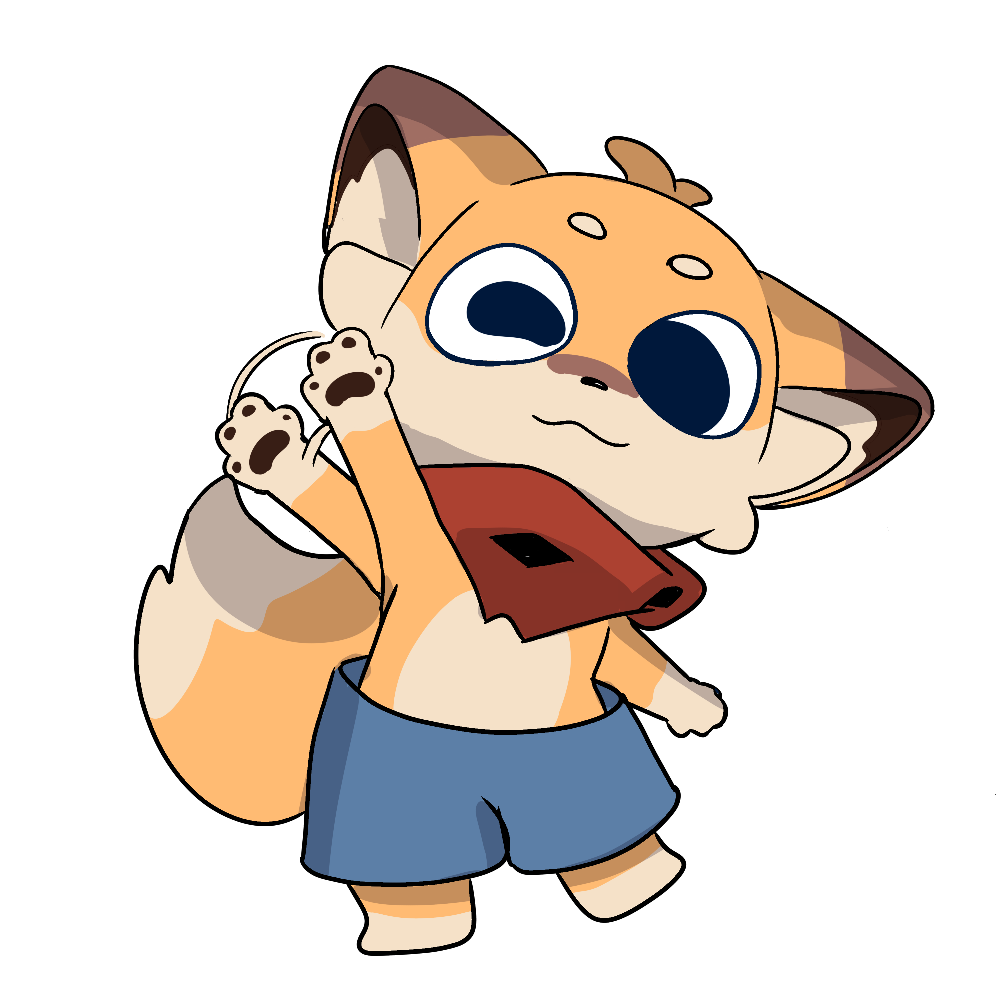

<div align="center">

  <a href="#">
    
  </a>

  <br />
  <br />

  <p><strong>Make every day count before interview day.</strong></p>
  <p>Company-aware interview preparation, shaped around your role, skills, and available time.</p>

  <p>
    <a href="YOUR_LIVE_URL_HERE" target="_blank">
      
    </a>
    &nbsp;
    <a href="YOUR_LINKEDIN_URL_HERE" target="_blank">
      
    </a>
    &nbsp;
    <a href="YOUR_YOUTUBE_URL_HERE" target="_blank">
      
    </a>
  </p>

  <p>
    <a href="#quick-start"><strong>🚀 Quick start</strong></a>
    &nbsp;·&nbsp;
    <a href="#why-prepamigo">Why PrepAmigo?</a>
    &nbsp;·&nbsp;
    <a href="#documentation">Documentation</a>
  </p>

</div>

<p align="center">
  
  
  
  
  
</p>

<p align="center">
  
  &nbsp;&nbsp;&nbsp;
  
  &nbsp;&nbsp;&nbsp;
  
</p>

> [!TIP]
> **The idea:** less time figuring out what to study, more time getting interview-ready. Start with your [local quick start](#quick-start) or jump to the [product overview](docs/PrepAmigo.md).

## Features & capabilities

<table>
  <tr>
    <td width="33%" align="center"><h3>🎯 Prepare with context</h3><p>Bring your target company, role, resume, and timeline into one preparation journey.</p></td>
    <td width="33%" align="center"><h3>🔎 Research the opportunity</h3><p>Gather company context, role requirements, job-market signals, and reported interview patterns.</p></td>
    <td width="33%" align="center"><h3>🧭 Find your focus</h3><p>Compare role needs with your background to identify and prioritize skill gaps.</p></td>
  </tr>
  <tr>
    <td width="33%" align="center"><h3>🗓️ Get a roadmap</h3><p>Organize priorities into sprints and day-by-day learning tasks around your timeframe.</p></td>
    <td width="33%" align="center"><h3>📚 Learn and practice</h3><p>Find relevant docs, books, papers, and videos; generate plan-aligned quizzes and flashcards.</p></td>
    <td width="33%" align="center"><h3>✨ Track what you know</h3><p>Stream agent progress and record learning topics, skill gaps, and assessment evidence.</p></td>
  </tr>
</table>

> [!NOTE]
> PrepAmigo is actively being built. Agent workflows and plan-generation capabilities are implemented, while some frontend screens still contain demo data. Live research and persistent learning memory depend on their optional providers.

## Why PrepAmigo

| Generic prep | PrepAmigo |
| --- | --- |
| One-size-fits-all checklists | Preparation informed by your role, background, and timeline |
| Search results without a next step | Research organized into focused priorities and tasks |
| Scattered notes and progress | A connected roadmap, learning resources, and progress view |

<p align="center">
  
  <strong>Not another link dump—a clearer answer to “what should I do next?”</strong>
</p>

## The agents behind your prep

PrepAmigo uses a LangGraph workflow and focused agents rather than asking one general chatbot to do every job.

| Agent / workflow | What it does |
| --- | --- |
| **Interview Prep Orchestrator** | Runs company research and job intelligence in parallel, coordinates the next stages, handles missing details, and assembles the preparation workflow. |
| **Company Research** | Collects company facts, products, technology context, and recent news. |
| **Job Intelligence** | Searches job listings and extracts recurring skills, seniority, responsibilities, and qualifications; broadens the search if company-specific listings are sparse. |
| **Skill Gap** | Compares the candidate's resume and current knowledge with role requirements and ranks focus areas. |
| **Content Research** | Finds relevant documentation, books, papers, videos, and transcripts, then synthesizes a learning module from selected sources. |
| **Planner** | Turns priority gaps and available days into a structured plan with sprints and daily tasks. |
| **Interview Intelligence** | Researches reported interview rounds, candidate experiences, questions, and process updates. |
| **Chat / Supervisor** | Routes general questions to the right specialist and keeps conversation context. |
| **Assessment & Flashcards** | Generates plan-aligned quizzes and revision cards from sprint topics. |

The workflow can request clarification when company, role, or location details are missing, and can resume on the same checkpoint thread when the candidate answers.

## How we use SerpApi efficiently

SerpApi powers live web, news, jobs, and video discovery. Each agent uses the search source suited to its task:

| Research task | Sources |
| --- | --- |
| Company context | Google Search and Google News |
| Role requirements | Google Jobs; falls back to a broader role search when company-specific listings are sparse |
| Interview patterns | Web results, related questions, videos, news, and optional Google AI Overview |
| Learning resources | Web results for technical material and YouTube videos; Google Scholar is an optional paper source |

For books and papers, the default integrations use Open Library and arXiv instead of spending SerpApi credits. YouTube transcripts are fetched separately with `youtube-transcript-api`. The Python research agents share one SerpApi client and response cache; the Node.js job-intelligence service also caches analyzed job profiles and enforces a per-user external-search rate limit.

- **Cache before calling:** exact-parameter search responses are cached for 7 days by default; fast-changing job and news results use a 1-day cache. Analyzed job profiles have their own MongoDB cache. Cache hits avoid another live request and don't count against the job-search rate limit.
- **Research only what fits:** skill-gap research is limited to the highest-priority gaps that can fit the planned schedule, with a configurable cap. Lower-priority gaps do not automatically trigger more paid searches.
- **Avoid paying twice for slow requests:** searches use SerpApi's asynchronous mode by default and retrieve completed results from its Search Archive; archive reads don't consume another search credit.
- **Bound concurrency and retries:** live-search concurrency is capped (4 by default); timeouts and retries are configurable. Account-level quota/key errors pause further live web searches temporarily.
- **Keep results focused:** routine Google web lookups suppress the slower AI Overview unless a workflow specifically needs it. Learning searches filter unsuitable sources, cap result counts, and run in parallel.
- **Develop without live-search spend:** disable SerpApi to use JSON fixtures or built-in mock results. Book catalog and paper searches can use Open Library and arXiv, and YouTube transcripts are fetched without SerpApi credits.

Live searches need `SERPAPI_API_KEY`. See the [agent service guide](agents-service/README.md) and [environment configuration](docs/guides/ENVIRONMENT_CONFIGURATION.md) for settings and offline fixture options.

## Your prep journey

<table>
  <tr>
    <td align="center" width="25%"><br /><strong>01 · Set your goal</strong><br /><sub>Company, role, and timeline</sub></td>
    <td align="center" width="25%"><br /><strong>02 · Find priorities</strong><br /><sub>Research the role and skill focus</sub></td>
    <td align="center" width="25%"><br /><strong>03 · Get a roadmap</strong><br /><sub>Organize study and practice</sub></td>
    <td align="center" width="25%"><br /><strong>04 · Make progress</strong><br /><sub>Complete tasks and track milestones</sub></td>
  </tr>
</table>

## Built with

| Tool / service | How PrepAmigo uses it |
| --- | --- |
| **React 19 · TypeScript · Vite · Tailwind CSS · Framer Motion** | Interactive web application and animated interface. |
| **Node.js · Express · MongoDB · Mongoose** | Application API, persistent application data, and job-intelligence profiles. |
| **Python · FastAPI · LangGraph · LangChain** | Agent APIs, specialist routing, and coordinated interview-prep workflows. |
| **Redis** | Relays agent progress between services and stores short-lived event history for server-sent-event (SSE) replay. |
| **Neo4j (optional)** | Persists the user knowledge graph: skills, topics, proficiency, learning state, and assessment evidence. In-memory/local storage is available without Neo4j. |
| **Ollama · OpenAI-compatible models (optional)** | Ollama is the default LLM provider; an optional fast-model endpoint can route smaller calls to another compatible provider. |
| **Mem0 (optional) · YouTube Transcript API** | Optional cross-session user memory; retrieve video transcripts without SerpApi search credits. |

> **Data note:** MongoDB stores app/API data; Redis is used for run coordination and streaming, not as the learning-plan database. Neo4j is an optional knowledge-graph backend and gracefully falls back when it is unavailable.

## Quick start

> [!IMPORTANT]
> PrepAmigo is under active development. Some screens use demo data, and complete local workflows need supporting services and model configuration. Follow the service guides for setup details.

**Prerequisites:** Node.js/npm, Python 3.11+ with `uv`, MongoDB, Redis, Ollama, and an Ollama model such as `llama3.1`.

Run each service in its **own terminal**. Configure the `.env` files using each service's `.env.example` first.

<details>
  <summary><strong>1 · Start the backend API</strong></summary>

```powershell
cd backend
Copy-Item .env.example .env
# Set MONGODB_URI in .env
npm install
npm run dev
```

API: <http://localhost:3000> · Health: <http://localhost:3000/health>
</details>

<details>
  <summary><strong>2 · Start the agent service</strong></summary>

```powershell
cd agents-service
Copy-Item .env.example .env
ollama pull llama3.1
uv sync --dev
uv run uvicorn --app-dir src main:app --reload
```

Agent API: <http://localhost:8000>. Live search is optional and requires a SerpApi key.
</details>

<details>
  <summary><strong>3 · Start the web app</strong></summary>

```powershell
cd frontend
Copy-Item .env.example .env
npm install
npm run dev
```

Open the Vite URL shown in your terminal (usually <http://localhost:5173>).
</details>

## Documentation

<p align="center">
  <a href="docs/PrepAmigo.md">Product overview</a> &nbsp;·&nbsp;
  <a href="agents-service/README.md">Agent service setup</a> &nbsp;·&nbsp;
  <a href="docs/agents/ORCHESTRATION_WORKFLOW.md">Agent workflow</a> &nbsp;·&nbsp;
  <a href="docs/api-docs/PLAN_PROGRESS_API.md">Plans API</a>
</p>

<p align="center">
  <a href="docs/guides/ENVIRONMENT_CONFIGURATION.md">Environment guide</a> &nbsp;·&nbsp;
  <a href="docs/agents/SSE_STREAMING_GUIDE.md">Streaming guide</a> &nbsp;·&nbsp;
  <a href="prepamigo-apis-bruno/">Bruno API collection</a>
</p>
