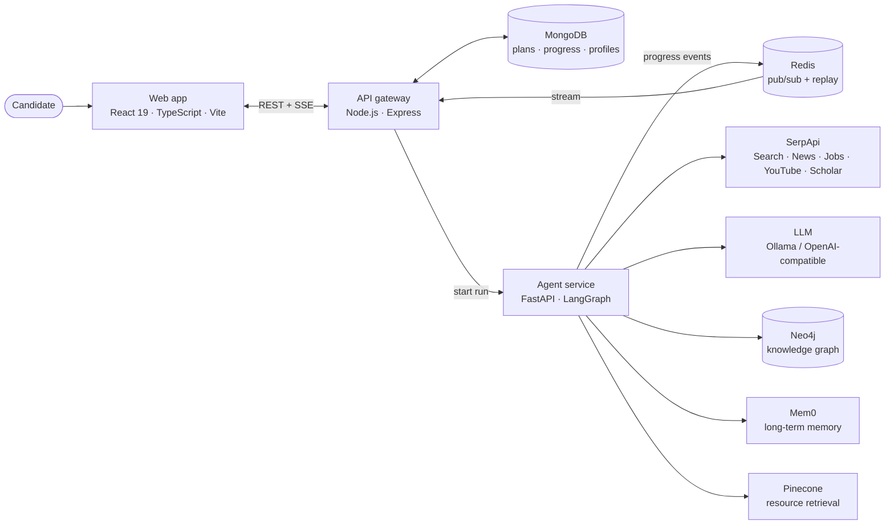

<div align="center">

  <p align="center">
    
    
  </p>

  <p><strong>Make every day count before interview day.</strong></p>
  <p>Company-aware interview preparation, shaped around your role, skills, and available time.</p>
</div>

<p align="center">
  
  
  
  
  
  
  
  
  
</p>

<div align="center">
  <p>
    <a href="https://prep-amigo.vercel.app"></a>
    <a href="https://youtu.be/0_rjFpytu-I"></a>
  </p>
</div>

<p align="center">
  
  &nbsp;&nbsp;&nbsp;
  
  &nbsp;&nbsp;&nbsp;
  
</p>

 <details>
    <summary><strong>Table of contents</strong></summary>
    <ul align="left">
      <li><a href="#the-problem">The problem</a></li>
      <li><a href="#the-solution">The solution</a></li>
      <li><a href="#why-prepamigo">Why PrepAmigo</a></li>
      <li><a href="#the-agents-behind-your-prep">The agents behind your prep</a></li>
      <li><a href="#architecture">Architecture</a></li>
      <li><a href="#how-we-use-serpapi-efficiently">How we use SerpApi efficiently</a></li>
      <li><a href="#your-prep-journey">Your prep journey</a></li>
      <li><a href="#tech-stack">Tech stack</a></li>
      <li><a href="#quick-start">Quick start</a></li>
      <li><a href="#documentation">Documentation</a></li>
    </ul>
  </details>


## The problem

Interview preparation is rarely blocked by a lack of resources. It is blocked by a lack of direction.

Candidates have to research a company, decode job requirements, identify their own gaps, find trustworthy material, and fit everything into a limited number of days. Generic checklists do not understand a candidate's resume, strengths, target role, or schedule.

## The solution

PrepAmigo is an **agentic learning orchestration system**. A candidate provides a target company, role, resume, current skills, and preparation window. A coordinated network of specialist agents then researches the opportunity, compares requirements with the candidate's starting point, prioritizes skill gaps, curates learning material, and produces a plan that can adapt as progress is recorded.

The shared Learning Context connects the whole workflow:

```text
What the company expects → What you already know → Which gaps matter most
        → What to learn → What to practise → What to revise before the interview
```

For example, a candidate with 45 days to prepare for a software-engineering role might be strong in React and Node.js but weak in DSA and system design. PrepAmigo uses current company and role signals to spend those 45 days on the gaps that matter most, then turns the result into sprints, daily tasks, resources, quizzes, flashcards, and measurable progress.

The system also maintains a living skills model. A global skill graph is refreshed from market signals, while each learner's graph records proficiency, learning state, and assessment evidence. As the candidate completes tasks and assessments, mastered topics consume less time and missed work can be rescheduled.


## Why PrepAmigo

<table>
  <thead><tr><th>Generic preparation</th><th>PrepAmigo</th></tr></thead>
  <tbody>
    <tr><td>One-size-fits-all checklists</td><td><strong>Context-aware direction</strong><br />The role, company, background, and timeline shape the preparation.</td></tr>
    <tr><td>Search results without a next step</td><td><strong>Actionable priorities</strong><br />Research becomes learning modules, tasks, and milestones.</td></tr>
    <tr><td>Separate notes and progress</td><td><strong>One connected journey</strong><br />Research, planning, practice, and progress stay connected.</td></tr>
  </tbody>
</table>

<p align="left">
  
  <strong>Not another link dump - a clearer answer to “what should I do next?”</strong>
</p>

## The agents behind your prep

PrepAmigo uses a LangGraph workflow and focused agents rather than asking one general chatbot to perform every job.

<table>
  <thead><tr><th>Agent / workflow</th><th>Responsibility</th></tr></thead>
  <tbody>
    <tr><td><strong>Interview Prep Orchestrator</strong></td><td>Coordinates research, handles missing details, and assembles the preparation workflow.</td></tr>
    <tr><td><strong>Company Research</strong></td><td>Collects company facts, products, technology context, and recent news.</td></tr>
    <tr><td><strong>Job Intelligence</strong></td><td>Analyses live listings for skills, seniority, responsibilities, and qualifications.</td></tr>
    <tr><td><strong>Skill Gap</strong></td><td>Compares the resume and current knowledge with role requirements.</td></tr>
    <tr><td><strong>Content Research</strong></td><td>Finds and synthesizes documentation, books, papers, videos, and transcripts.</td></tr>
    <tr><td><strong>Planner</strong></td><td>Turns priority gaps and available days into sprints, tasks, and milestones.</td></tr>
    <tr><td><strong>Interview Intelligence</strong></td><td>Researches reported interview rounds, questions, candidate experiences, and process changes.</td></tr>
    <tr><td><strong>Chat / Supervisor</strong></td><td>Routes questions to the right specialist while retaining conversation context.</td></tr>
    <tr><td><strong>Assessment &amp; Flashcards</strong></td><td>Generates plan-aligned practice and feeds evidence back into the learner model.</td></tr>
  </tbody>
</table>

When company, role, or location details are missing, the workflow can pause with a clarification request and resume from the same LangGraph checkpoint after the candidate responds.

## Architecture



### The preparation pipeline

| Stage | Agents | What happens |
| --- | --- | --- |
| **1 · Market intelligence** (parallel) | Company Research · Job Intelligence | Company facts and news are gathered while live job postings are analysed for recurring skills and seniority signals. |
| **2 · Gap analysis** | Skill Gap | The resume and stated strengths are compared with role requirements to produce a ranked gap list. |
| **3 · Learning research** | Content Research | Docs, books, papers, videos, and transcripts are found and synthesized per priority gap. |
| **4 · Planning** | Planner | Gaps and available days become sprints, daily tasks, milestones, and revision cycles. |
| **5 · Synthesis** | Evaluator | Results are validated, packaged into the structured plan, and saved for the dashboard. |

### Engineering highlights

- **Live progress, not a spinner.** Agent steps and tool calls stream to the browser over Server-Sent Events, relayed through Redis pub/sub with history replay, 15-second heartbeats, and a worker-silence watchdog.
- **Pause, ask, resume.** Missing inputs pause the LangGraph run with a clarification question; the answer resumes the same checkpoint thread. Idempotency keys prevent duplicate work on retries.
- **Grounded outputs.** Curated links come from tool results. Job requirements are built from target-employer postings, with a flagged broader role search when postings are sparse.
- **Current learner context.** Neo4j stores the user knowledge graph—skills, concepts, proficiency, learning state, and assessment evidence—so future plans can account for what the learner has already mastered.
- **Reliable under partial failure.** Partial results are returned when a branch fails, budgets are enforced per stage, and every step and tool call is timed in structured logs.
- **Tested.** The agent service includes coverage for caching, rate budgets, relevance filtering, streaming, memory adapters, plan validation, and end-to-end pipeline robustness.

## How we use SerpApi efficiently

SerpApi is a **core dependency**: it grounds PrepAmigo's company, role, interview, and learning recommendations in current information. Each agent uses the source suited to its task:

| Research task | Sources |
| --- | --- |
| Company context | Google Search and Google News |
| Role requirements | Google Jobs; broader role search when company-specific listings are sparse |
| Interview patterns | Web results, related questions, videos, news, and Google AI Overview |
| Learning resources | Web results, YouTube, and Google Scholar for papers |

Books and papers can also use Open Library and arXiv to reduce SerpApi usage, while video transcripts are fetched separately with `youtube-transcript-api`. The Python research agents share one SerpApi client and response cache; the Node.js job-intelligence service caches analysed job profiles and enforces a per-user external-search rate limit.

- **Cache before calling:** exact-parameter responses are cached for seven days; fast-changing job and news results use a one-day cache. Analysed job profiles have a separate MongoDB cache.
- **Research only what fits:** only the highest-priority gaps that fit the schedule trigger further searches.
- **Avoid paying twice:** searches use asynchronous mode by default and retrieve completed results from SerpApi's Search Archive.
- **Bound concurrency and retries:** live-search concurrency is capped, timeouts and retries are configurable, and quota errors temporarily pause further live searches.
- **Keep results focused:** routine web lookups suppress the slower AI Overview unless a workflow explicitly needs it; learning searches filter unsuitable sources and cap result counts.
Live searches require `SERPAPI_API_KEY`. See the [agent service guide](agents-service/README.md) and [environment configuration](docs/guides/ENVIRONMENT_CONFIGURATION.md) for configuration details.

## Your prep journey

<table>
  <tr>
    <td align="center" width="25%"><br /><strong>01 · Set your goal</strong><br /><sub>Company, role, and timeline</sub></td>
    <td align="center" width="25%"><br /><strong>02 · Find priorities</strong><br /><sub>Research the role and skill focus</sub></td>
    <td align="center" width="25%"><br /><strong>03 · Get a roadmap</strong><br /><sub>Organize study and practice</sub></td>
    <td align="center" width="25%"><br /><strong>04 · Make progress</strong><br /><sub>Complete tasks and track milestones</sub></td>
  </tr>
</table>

Preparation is gamified around real activity: streaks, XP, badges, titles, sprint completion, skill levels, and milestones are credited from completed tasks and assessment performance.

## Tech stack


<p>
  
</p> 


| Area | Technologies | Role in PrepAmigo |
| --- | --- | --- |
| Frontend | React 19, TypeScript, Vite, Tailwind CSS, Framer Motion | Interactive preparation workspace and progress experience |
| API | Node.js, Express, MongoDB | Authentication, application APIs, plan persistence, and job-intelligence profiles |
| Agent service | Python 3.11+, FastAPI, LangGraph, LangChain | Specialist agents, orchestration, synthesis, and streaming telemetry |
| Live intelligence | SerpApi, YouTube Transcript API, Open Library, arXiv | Current company, job, interview, and learning evidence |
| AI and memory | Ollama, OpenAI-compatible models, Mem0 | Model inference and cross-session conversational memory |
| Knowledge and retrieval | Neo4j, Pinecone | Learner knowledge graph and resource retrieval |
| Infrastructure | Redis, Server-Sent Events, Vercel, Render, GitHub Actions | Event streaming, deployment, and service keep-alive jobs |

SerpApi and Neo4j are core architectural components. MongoDB remains the system of record for application data, while Redis coordinates runs and replays streaming events.

## Quick start

**Prerequisites:** Node.js/npm, Python 3.11+ with `uv`, MongoDB, Redis, Ollama, and an Ollama model such as `llama3.1`. For the full live experience, also configure SerpApi and Neo4j credentials in the agent-service environment.

Run each service in its **own terminal**. Configure the `.env` files using each service's `.env.example` first.

<details>
  <summary><strong>1 · Start the backend API</strong></summary>

```powershell
cd backend
Copy-Item .env.example .env
# Set MONGODB_URI in .env
npm install
npm run dev
```

API: <http://localhost:3000> · Health: <http://localhost:3000/health>
</details>

<details>
  <summary><strong>2 · Start the agent service</strong></summary>

```powershell
cd agents-service
Copy-Item .env.example .env
ollama pull llama3.1
uv sync --dev
uv run uvicorn --app-dir src main:app --reload
```

Agent API: <http://localhost:8000>. Configure `SERPAPI_API_KEY`, `SERPAPI_ENABLED=true`, and the Neo4j connection variables for live research and persistent learner-graph storage.
</details>

<details>
  <summary><strong>3 · Start the web app</strong></summary>

```powershell
cd frontend
Copy-Item .env.example .env
npm install
npm run dev
```

Open the Vite URL shown in your terminal (usually <http://localhost:5173>).
</details>

## Documentation

<p align="center">
  <a href="docs/PrepAmigo.md">Product overview</a> &nbsp;·&nbsp;
  <a href="agents-service/README.md">Agent service setup</a> &nbsp;·&nbsp;
  <a href="docs/agents/ORCHESTRATION_WORKFLOW.md">Agent workflow</a> &nbsp;·&nbsp;
  <a href="docs/api-docs/PLAN_PROGRESS_API.md">Plans API</a>
</p>

<p align="center">
  <a href="docs/guides/ENVIRONMENT_CONFIGURATION.md">Environment guide</a> &nbsp;·&nbsp;
  <a href="docs/agents/SSE_STREAMING_GUIDE.md">Streaming guide</a> &nbsp;·&nbsp;
  <a href="prepamigo-apis-bruno/">Bruno API collection</a>
</p>
