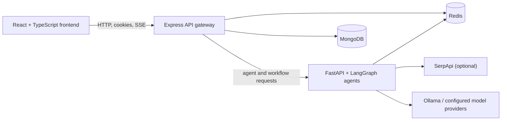

<p align="center">
  <a href="#">
    
    <span style="font-size: 52px; font-weight: 800; color: #E88D43; vertical-align: middle; font-family: -apple-system, BlinkMacSystemFont, 'Segoe UI', Roboto, Helvetica, Arial, sans-serif;">PrepAmigo</span>
  </a>
</p>

<p align="center">
  <strong>Personalized interview preparation, coordinated by specialized multi AI agents.</strong>
</p>

---

PrepAmigo brings company and role research, skill-gap analysis, curated learning resources, and a day-by-day study plan into one preparation workspace. The repository contains a React frontend, an Express API, and a Python/FastAPI LangGraph agent service.

> **Project status:** This is an actively developed project. Some screens still use local demo data; backend-backed plans, notifications, authentication, and agent workflows are available where configured. Review the setup notes below before expecting every screen to use live data.

[Architecture](#architecture) · [Getting started](#getting-started) · [Documentation](#documentation) · [Contributing](CONTRIBUTING.md) · [Security](SECURITY.md)

## What PrepAmigo does

- Builds interview preparation around a target company, role, candidate profile, and available time.
- Uses specialist agents for company research, job intelligence, interview intelligence, skill-gap analysis, learning research, planning, and assessments.
- Streams agent activity and results to the application through the backend.
- Tracks study plans, sprints, daily tasks, assessments, notifications, and progress.
- Supports local model development with Ollama and optional external search/model providers.

## Architecture



The browser is served by Vite during development. The Express service owns application APIs, authentication, and persisted user plans. The Python service runs the LangGraph agent workflows. Redis is used for background agent event delivery and replay; MongoDB stores application data.

## Repository layout

| Path | Purpose |
| --- | --- |
| [`frontend/`](frontend/README.md) | React 19, TypeScript, and Vite application |
| [`backend/`](backend/) | Express/TypeScript API, MongoDB models, auth, and application services |
| [`agents-service/`](agents-service/README.md) | FastAPI service, LangGraph agents, streaming, and CLI |
| [`docs/`](docs/README.md) | Architecture, API references, setup guides, and workflow documentation |
| [`prepamigo-apis-bruno/`](prepamigo-apis-bruno/) | Bruno API collection and local example environment |

## Getting started

### Prerequisites

- Node.js and npm (use a current Node.js LTS release).
- Python 3.11 or newer and [uv](https://docs.astral.sh/uv/).
- MongoDB for the Express API.
- Redis for background agent streaming and event replay.
- [Ollama](https://ollama.com/) and a locally available model for the default Python agent setup. An API key is needed only for optional hosted providers and live SerpApi search.

Install and start MongoDB, Redis, and Ollama using your preferred local setup. The application services are run separately in the following steps. Run each service in its own PowerShell terminal.

### 1. Configure and start the API

```powershell
cd backend
Copy-Item .env.example .env
```

Edit `backend/.env` and set `MONGODB_URI`. Set `JWT_SECRET` before enabling authentication or running in production. The local API defaults to `http://localhost:3000`.

```powershell
npm install
npm run dev
```

Check that it is responding at [`http://localhost:3000/health`](http://localhost:3000/health).

### 2. Configure and start the agent service

In another terminal:

```powershell
cd agents-service
Copy-Item .env.example .env
```

The default agent provider is local Ollama. Install the configured model if it is not already available:

```powershell
ollama pull llama3.1
```

Then install Python dependencies and start FastAPI:

```powershell
uv sync --dev
uv run uvicorn --app-dir src main:app --reload
```

The agent API listens on port `8000` by default. Live web research requires a SerpApi key; fixture mode is available for development without live search. See the [agent service guide](agents-service/README.md) for provider, streaming, and workflow details.

### 3. Configure and start the frontend

In a third terminal:

```powershell
cd frontend
Copy-Item .env.example .env
```

The example configures `VITE_API_URL=http://localhost:3000`, matching the backend's local port. Adjust it if your API is listening elsewhere.

```powershell
npm install
npm run dev
```

Open the Vite URL printed in the terminal (normally [`http://localhost:5173`](http://localhost:5173)).

### Local configuration notes

- Keep credentials in each service's ignored `.env` file. Never commit populated environment files.
- Authentication is disabled by default for local development. Production always requires a valid JWT on protected backend routes.
- Set the same JWT secret in the backend and agent service if you enable token verification for both.
- `VITE_ENABLE_AUTH` and `VITE_ENABLE_SERPAPI` are frontend feature flags; backend/provider configuration is controlled separately.
- See [environment configuration](docs/guides/ENVIRONMENT_CONFIGURATION.md) and the three committed templates: [`backend/.env.example`](backend/.env.example), [`agents-service/.env.example`](agents-service/.env.example), and [`frontend/.env.example`](frontend/.env.example).

## Tests and checks

Run these from the relevant service directory:

| Service | Command | Purpose |
| --- | --- | --- |
| Frontend | `npm run lint` | ESLint checks |
| Frontend | `npm run build` | TypeScript project build and Vite production build |
| Backend | `npm run build` | TypeScript compilation |
| Agents | `uv run pytest` | Python test suite |

For interactive agent workflow checks and examples, see the [CLI testing guide](docs/guides/CLI_TESTING_GUIDE.md).

## API and request examples

- [Plans and progress API](docs/api-docs/PLAN_PROGRESS_API.md)
- [Company research API](docs/api-docs/Company-Research-Agent-API-Reference.md)
- [Bruno collection](prepamigo-apis-bruno/) — import the collection and use `environments/local.example.yml` as a starting point for local requests.
- FastAPI interactive API docs are available at [`http://localhost:8000/docs`](http://localhost:8000/docs) while the agent service is running.

## Documentation

Start at the [documentation index](docs/README.md). It links the product overview, agent architecture, APIs, configuration, and operating guides.

## Contributing

Bug reports, documentation improvements, and focused pull requests are welcome. Read [CONTRIBUTING.md](CONTRIBUTING.md) before making changes. Use the issue forms in GitHub to report bugs or propose features.

## License

There is currently no top-level `LICENSE` file in this repository. The `ISC` value in the backend package manifest applies to that package's metadata and does not establish a license for the complete repository. Please contact the maintainers before redistributing or using this project where a license grant is required.
