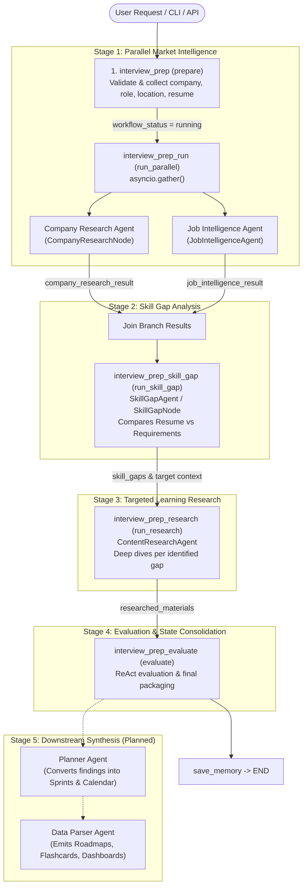

# PrepAmigo Multi-Agent Orchestration Workflow

This document provides a comprehensive technical architecture and data specification for the **PrepAmigo Multi-Agent Interview Preparation Pipeline**. It covers:
1. End-to-end orchestration flow and architecture diagram.
2. State passing mechanics, exact keys, and lifecycle within LangGraph `AgentState`.
3. Agent-by-agent tasks, inputs, outputs, and exact SerpApi engines/parameters used.
4. Downstream integration contract for the upcoming **Planner Agent** and **Data Parser Agent**.

---

## 1. High-Level Architecture & Execution Flow

The interview preparation workflow operates as a stateful, bounded, sequential pipeline coordinated by `InterviewPrepOrchestrator`. Two specialist branches execute concurrently in Stage 1, after which downstream agents run sequentially to refine and research candidate gaps.



---

## 2. State Passing Mechanics & Contracts

All agents communicate by reading from and writing to a shared LangGraph state dictionary typed as `AgentState` (`agents-service/src/graph/state.py`).

### 2.1 Core State Blackboard (`task_context`)

The `task_context` dictionary serves as the central structured blackboard across all agents. Unlike `messages` (which stream raw conversational text), `task_context` carries strongly-typed, schema-validated artifacts.

```
AgentState
├── messages: Annotated[list[BaseMessage], add_messages]
├── user_id: str
├── workflow_mode: "interview_prep"
├── interview_prep_input: { "company", "role", "location" }
├── task_context:
│   ├── candidate_resume_text: str (Candidate resume markdown/plaintext)
│   ├── target_company: str        (Normalized company name)
│   ├── target_role: str           (Normalized role name)
│   ├── company_profile: dict      (Output from CompanyResearchAgent)
│   ├── job_intelligence: dict     (Output from JobIntelligenceAgent)
│   ├── skill_gap: dict            (Output from SkillGapAgent)
│   └── interview_prep: dict       (Consolidated package from evaluate)
├── skill_gaps: list[str]          (Specific gap topics passed to Research Agent)
├── researched_materials: list[dict] (Synthesized learning modules from ContentResearchAgent)
├── execution_events: list[dict]   (Internal telemetry & duration measurements)
└── handoffs: list[dict]           (Compact summaries passed between agents)
```

### 2.2 End-to-End Data Flow Matrix

| Stage | Producing Agent | Data Written / Updated | Consumed By | Purpose |
|---|---|---|---|---|
| **0. Init** | Orchestrator (`prepare`) | `interview_prep_input`, `task_context["candidate_resume_text"]` | `run_parallel`, `run_skill_gap` | Normalizes target parameters and user resume |
| **1a. Company** | `CompanyResearchAgent` | `company_research_result["data"]["profile"]` | `run_skill_gap` | Tech stack, architecture, culture, news |
| **1b. Job Market** | `JobIntelligenceAgent` | `job_intelligence_result["data"]` | `run_skill_gap` | Real-world job requirements, skill frequencies |
| **2. Skill Gap** | `SkillGapAgent` | `task_context["skill_gap"]`, `state["skill_gaps"]` | `run_research`, `PlannerAgent` | Prioritized missing/partial skills, readiness score |
| **3. Research** | `ContentResearchAgent` | `state["researched_materials"]` | `evaluate`, `PlannerAgent` | Curated docs, books, academic papers, video tutorials |
| **4. Packaging** | Orchestrator (`evaluate`) | `task_context["interview_prep"]` | Downstream API / Planner | Complete verified payload ready for planning |

---

## 3. Agent Details & SerpApi Specifications

### 3.1 Company Research Agent
* **File**: [`agents/company_research_agent.py`](file:///C:/project/PrepAmigo-Multi-Agent-Personalized-Preparation-System/agents-service/src/agents/company_research_agent.py) (wrapped by [`CompanyResearchNode`](file:///C:/project/PrepAmigo-Multi-Agent-Personalized-Preparation-System/agents-service/src/agents/company_research_node.py))
* **Primary Task**: Conducts deep background research into the target company's engineering blog, infrastructure choices, system architecture, company culture, leadership, financials, and recent news.
* **SerpApi Engines & APIs Used**:
  1. **Google Web Search (`engine: "google"`)**
     * **Tool**: `search_company_overview` in `tools/company_research_tools.py`
     * **Parameters**:
       * `engine`: `"google"`
       * `q`: `"{company} company engineering tech stack"` (or role-tailored e.g. `"{company} backend engineering tech stack architecture"`)
       * `gl`: `"us"`, `hl`: `"en"`
     * **Extracted Data**: Google Knowledge Graph (`headquarters`, `founders`, `employees`, `revenue`, `stock_ticker`, `sitelinks`), organic engineering search results, discussions & forums, and related questions.
  2. **Google News Search (`engine: "google_news"`)**
     * **Tool**: `search_company_news` in `tools/company_research_tools.py`
     * **Parameters**:
       * `engine`: `"google_news"`
       * `q`: `"{company}"`
       * `gl`: `"us"`, `hl`: `"en"`
     * **Extracted Data**: Recent news headlines, dates, source publications, and nested related stories.
* **Output Schema**: `company_profile` dict containing `name`, `industry`, `website`, `description`, `context_snippets`, `organic_results`, `recent_developments`, and `knowledge_graph`.

---

### 3.2 Job Intelligence Agent
* **File**: [`agents/job_intelligence_agent.py`](file:///C:/project/PrepAmigo-Multi-Agent-Personalized-Preparation-System/agents-service/src/agents/job_intelligence_agent.py)
* **Primary Task**: Analyzes live hiring market postings for the requested role and company to identify recurring technical skills, qualifications, seniority distributions, and common responsibilities.
* **SerpApi Engines & APIs Used**:
  1. **Google Jobs Search (`engine: "google_jobs"`)**
     * **Tool**: `fetch_google_jobs`
     * **Parameters**:
       * `engine`: `"google_jobs"`
       * `q`: `"{company} {role}"` (if location is `"Remote"`, appends `"remote"` to `q` e.g. `"{company} {role} remote"`)
       * `location`: Geographic location (e.g. `"San Francisco, CA"`, omitted if remote)
       * `hl`: `"en"`, `gl`: `"us"`
     * **Extracted Data**: Job titles, employer names, locations, and descriptions.
* **Fallback & Resilience Mechanisms**:
  * **Role Fallback**: If specific company postings return 0 results, automatically falls back to search broader industry postings for `{role}`.
  * **LLM Synthesis Fallback**: If 0 live postings exist across the web, uses the LLM to synthesize standard industry requirements for the role so downstream agents never receive an empty list.
  * **Cache Resilience**: Tests MongoDB connection with a fast non-blocking ping; gracefully skips local cache without stack traces if MongoDB is offline.
* **Output Schema**: `JobIntelligenceProfile` dict containing `skills` (with names, frequency, and priority), `seniorityDistribution`, `employmentTypes`, `commonResponsibilities`, and `commonQualifications`.

---

### 3.3 Skill Gap Agent
* **File**: [`agents/skill_gap_agent.py`](file:///C:/project/PrepAmigo-Multi-Agent-Personalized-Preparation-System/agents-service/src/agents/skill_gap_agent.py) (wrapped by [`SkillGapNode`](file:///C:/project/PrepAmigo-Multi-Agent-Personalized-Preparation-System/agents-service/src/agents/skill_gap_node.py))
* **Primary Task**: Performs comparative analysis between candidate capabilities (parsed from resume text) and requirements collected by Company Research and Job Intelligence.
* **SerpApi Usage**: **None** (pure LLM reasoning and deterministic scoring).
* **Internal Execution Pipeline**:
  1. `_build_candidate_profile(resume_text)`: LLM extracts explicit skills, projects, experience, and education from user resume.
  2. `_evaluate_gaps(candidate_profile, required_skills, company, role, company_profile)`: LLM matches candidate background against target company requirements, classifying each skill as `strong`, `partial`, or `missing`.
  3. `_rank_and_score(gap_evaluation, required_skills)`: Pure Python prioritization. Calculates candidate `readiness_score` (0–100%) and sorts gaps by priority (Missing > Partial, weighted by market frequency).
* **Output Schema**:
  * `task_context["skill_gap"]`: Full report with `readiness_score`, `matched_skills`, `partial_skills`, `missing_skills`, `extra_skills`, and `priority_gaps`.
  * `state["skill_gaps"]`: Clean `list[str]` of top gap names (e.g. `["Distributed Systems", "Kubernetes"]`) forwarded directly to `ContentResearchAgent`.

---

### 3.4 Content Research Agent
* **File**: [`agents/research_agent.py`](file:///C:/project/PrepAmigo-Multi-Agent-Personalized-Preparation-System/agents-service/src/agents/research_agent.py) (wrapped by [`ResearchNode`](file:///C:/project/PrepAmigo-Multi-Agent-Personalized-Preparation-System/agents-service/src/agents/research_node.py))
* **Primary Task**: For every gap topic passed in `state["skill_gaps"]`, compiles a curated learning module containing verified documentation links, books, research papers, video tutorials, and interactive exercises.
* **SerpApi Engines & APIs Used**:
  1. **Google Technical Documentation Search (`engine: "google"`)**
     * **Tool**: `search_technical_docs` in `tools/research_tools.py`
     * **Query**: `"{topic} fundamentals official documentation"` (or `"internals deep dive"` for advanced depth)
     * **Filters**: Sanitizes links, excludes social media platforms (Twitter, LinkedIn, Facebook, Reddit).
  2. **Google Books Search (`engine: "google"`)**
     * **Tool**: `search_books` in `tools/research_tools.py`
     * **Query**: `"{topic} best books to learn"` (plain Google search customized for reference books).
  3. **Google Scholar (`engine: "google_scholar"`)**
     * **Tool**: `search_academic_papers` in `tools/research_tools.py`
     * **Query**: `"{topic} paper"` or `"{topic} survey OR review paper"`
     * **Condition**: Active for `intermediate` and `advanced` curation depths.
  4. **YouTube Search (`engine: "youtube"`)**
     * **Tool**: `search_youtube_tutorials` in `tools/research_tools.py`
     * **Query**: `"{topic} tutorial for {role}"` or `"{topic} {company} interview deep dive"`
     * **Secondary API**: Uses `youtube-transcript-api` (direct, no SerpApi credits) to fetch verbatim transcripts from the top video tutorials for citation extraction.
* **Output Schema**: `state["researched_materials"]` list of learning module objects:
  ```json
  {
    "id": "module-3f8a92...",
    "topic": "Distributed Systems",
    "target_role": "Backend Engineer",
    "target_company": "Anthropic",
    "depth": "intermediate",
    "content_markdown": "# Learning Guide: Distributed Systems\n...",
    "resources": [
      { "title": "Raft Consensus", "url": "https://raft.github.io", "resource_type": "documentation" }
    ],
    "transcripts": [ ... ],
    "uses_mock_sources": false,
    "generated_at": "2026-09-30T21:29:39Z"
  }
  ```

---

## 4. Downstream Contract: Planner Agent & Data Parser

The orchestration pipeline guarantees that once Stage 4 (`interview_prep_evaluate`) completes, the LangGraph state contains all prerequisites for the **Planner Agent** and **Data Parser Agent**:

```
State available to Planner Agent:
├── task_context["company_profile"]   ──► Company context, interview culture, engineering stack
├── task_context["job_intelligence"]  ──► Role requirements, responsibility weights
├── task_context["skill_gap"]         ──► Candidate readiness score, missing skills
└── state["researched_materials"]     ──► Verified documentation, tutorials, textbooks, exercises
```

### Planned Downstream Tasks:
1. **Planner Agent**:
   * Reads `task_context["skill_gap"]["priority_gaps"]` and `state["researched_materials"]`.
   * Allocates learning topics into realistic study sprints (Day 1..N), daily tasks, and revision checkpoints.
2. **Data Parser Agent**:
   * Transforms planner schedules into user-facing schemas:
     * **Roadmap**: Day-by-day objectives, time estimates, reference links.
     * **Calendar**: Event schedule, reminders, rescheduling handlers.
     * **Resource Pack**: Curated links and video transcripts.
     * **Assessments**: Weekly quizzes and flashcards generated directly from `researched_materials`.
     * **Progress Dashboard**: Gamified XP, milestones, and badge progression.

---

## 5. Offline vs Live SerpApi Operation

| Mode | Trigger in `.env` | Behavior |
|---|---|---|
| **Live Production** | `SERPAPI_ENABLED=true`<br>`SERPAPI_API_KEY=...` | Live queries to Google, Google News, Google Jobs, Google Scholar, and YouTube. All successful responses cached locally in `.data/research_cache/` to avoid burning duplicate credits. |
| **Offline Development** | `SERPAPI_ENABLED=false` | Loads pre-recorded JSON fixture from `SERPAPI_DUMMY_DATA_PATH=serpapi_fixtures.example.json`. Bypasses all live network calls, enabling free and offline end-to-end testing. |
