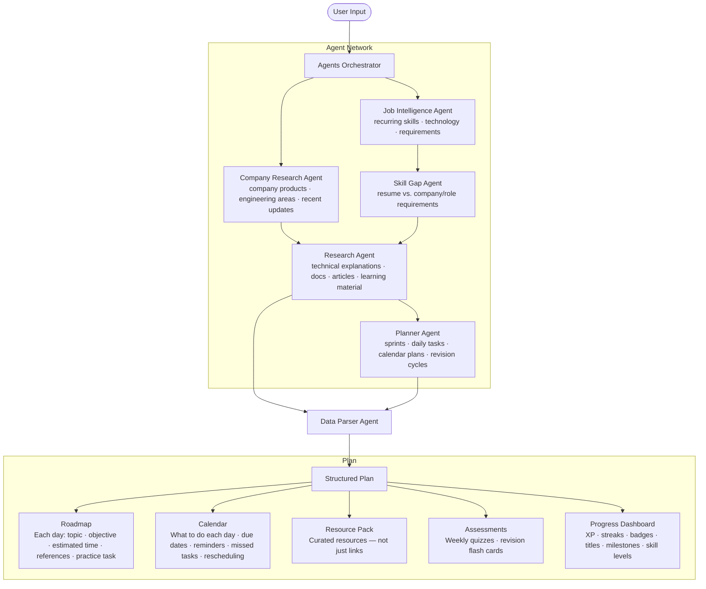

# **PrepAmigo** 

### **Multi-Agent Personalized Preparation System** 

## **Problem Statement** 

Preparing for a company-specific interview is not just about studying more. The real problem is knowing **what to study, what to prioritize, and how to use limited preparation time** . 

Candidates usually have to manually research company interview patterns, job requirements, candidate experiences, learning resources, and technical topics, then compare all of this against their own resume and current skill level. This creates a fragmented preparation process where candidates often spend more time deciding **what to prepare** than actually preparing. 

The real problem is not finding learning resources. It is **coordinating company requirements, candidate gaps, available preparation time, and learning activities into one adaptive preparation system.** 

## **Solution** 

**PrepAmigo is an agentic learning orchestration system that creates and manages a personalized preparation journey for a specific company, role, and timeframe.** 

The candidate provides: 

- Target company and role 

- Preparation timeframe 

- Resume 

- Current knowledge, strengths, and weaknesses 

At the centre is a single PrepAmigo interface. The candidate tells the system what they are preparing for, while a **network of specialized agents** handles the underlying research, analysis, planning, resource discovery, assessment, and adaptation. 

The system maintains a shared **Learning Context** containing the target role, company information, job requirements, interview patterns, candidate skills, resume, knowledge gaps, preparation deadline, completed topics, resources, progress, and learning constraints. 

## **Specialized Agents** 

1. **Company Research Agent** - company products, technology, engineering areas, recent developments, and relevant information 

2. **Job Intelligence Agent** - analyzes job descriptions and identifies recurring skills, technologies and requirements 

3. **Interview Intelligence Agent** - researches interview rounds, commonly reported topics, question patterns and candidate experiences 

4. **Skill Gap Agent** - compares company/role requirements against the candidate's resume and current state 

5. **Research Agent** - finds technical explanations, documentation, articles and learning material 

6. **Planner Agent** - converts all findings into sprints, daily tasks, calendar plans and revision cycles 

7. **Data Parser Agent** - consumes outputs from the Research and Planner Agents and emits the structured Plan consumed by the frontend 

8. **Assessment Agent** - evaluates progress through quizzes, coding tasks and mock interviews 

9. **Progress Agent** - tracks completion, performance, streaks, XP, badges and learning velocity 

---

## **Agent Architecture & Flow**

User input enters the **Agents Orchestrator**, which fans out to specialist agents in a defined sequence. The orchestrator coordinates the pipeline; no agent calls another directly.



### **Pipeline Stages**

| Stage | Agents | What happens |
|---|---|---|
| **1 — Market Intelligence** (parallel) | Company Research Agent · Job Intelligence Agent | Orchestrator fans out to both simultaneously. Company Research gathers company facts, engineering context, and recent news. Job Intelligence fetches live job postings and extracts recurring skills, seniority signals, and responsibilities. |
| **2 — Gap Analysis** | Skill Gap Agent | Receives Job Intelligence output. Compares the candidate's resume and stated strengths/weaknesses against the role requirements to produce a ranked gap list. |
| **3 — Learning Research** | Research Agent | Receives both Company Research output (for cultural/tech context) and Skill Gap output (for targeted topics). Finds technical explanations, documentation, articles, videos, and transcripts per identified gap. |
| **4 — Planning** | Planner Agent | Receives Research Agent output. Converts curated resources and gap priorities into a sprint-based study schedule with daily tasks, milestones, and revision cycles. |
| **5 — Plan Synthesis** | Data Parser Agent | Receives output from both Research Agent and Planner Agent. Produces the fully structured Plan: Roadmap, Calendar, Resource Pack, Assessments, and Progress Dashboard. |

### **Plan Output**

| Component | Description |
|---|---|
| **Roadmap** | Day-by-day view. Each day contains a topic, objective, estimated study time, curated references, and a practice task. |
| **Calendar** | Scheduling layer. Shows what to work on each day, handles due dates, reminders, missed tasks, and rescheduling. |
| **Resource Pack** | A curated set of resources per gap — not a raw link dump. Videos, articles, docs, and books selected by the Research Agent. |
| **Assessments** | Weekly quizzes and revision flash cards generated from the topics covered in each sprint. |
| **Progress Dashboard** | Gamification layer. Tracks XP, streaks, badges, titles, milestones, and per-skill levels. |

---

## **How It Works** 

The system researches the target company and role, understands the candidate's current state, identifies the highest-impact gaps, and creates a preparation plan around the available timeframe. 

As the candidate completes tasks or performs poorly in an assessment, PrepAmigo updates the Learning Context and adjusts upcoming sprints and priorities. 

## **Example** 

**"I have 45 days to prepare for a Software Engineer role at Company X. Here's my resume. I'm strong in React and Node.js but weak in DSA and system design."** 

Instead of simply generating a study timetable, PrepAmigo determines: 

**What the company expects → What the candidate already knows → What gaps matter most → What should be learned → Which resources to use → What should be practiced → How much time each topic deserves → What should be revised before the interview** 

## **Gamification** 

PrepAmigo turns preparation into a measurable progression system through: 

**Streaks · XP · Badges · Trophies · Titles · Sprint Completion · Skill Levels · Milestones** 

Progress is based on actual preparation activity and assessment performance rather than simply spending time in the application. 

## **USP** 

A single preparation interface backed by specialized agents and a shared Learning Context that understands **what a company expects, what a candidate already knows, what they are missing, and how much time they have** , then continuously coordinates research, learning, practice, assessment, and planning around that goal. 

**Tell PrepAmigo where you want to go. It figures out what you need to learn next.** 

### **1. Company Research Agent** 

**Goal:** Research company products, technology, engineering areas, recent developments, and relevant culture/background information for downstream agents (Skill Gap, Planner, Interview Intelligence) in the shared Learning Context.

> **Why only 2 APIs?**
> The Google Search API response already bundles the knowledge graph (structured facts), organic results (engineering blogs and tech stack), related questions (culture/expectation signals), and discussions & forums (candid Reddit/Blind-style chatter) into a single call. Together with the Google News API covering recent developments (launches, acquisitions, funding), these 2 endpoints replace the need for separate Trends, Forums, Images, AI Overview, and Finance calls for this agent's scope, reducing latency and quota consumption.

- **Google Search API (Primary — Company Facts, Products, Tech Stack, Culture):**
  - **Endpoint:** `GET https://serpapi.com/search.json`
  - **Required Params:** `engine=google`, `q`, `api_key`
  - **Recommended Params:** `num=10`, `hl=en`, `gl=us`
  - **Response fields stored in Learning Context:**
    - `knowledge_graph`: Structured facts (industry, founded, HQ, description)
    - `organic_results[]`: Titles, links, snippets (engineering blogs, docs, career pages)
    - `related_questions[]`: Questions, snippets (culture/expectation signals)
    - `discussions_and_forums[]`: Titles, links, sources (Reddit/Blind-style chatter)

- **Google News API (Recent Developments — Launches, Funding, Announcements):**
  - **Endpoint:** `GET https://serpapi.com/search.json`
  - **Required Params:** `engine=google_news`, `q`, `api_key`
  - **Recommended Params:** `gl=us`, `hl=en`
  - **Response fields stored in Learning Context:**
    - `news_results[]`: Titles, links, sources, dates, snippets 

### **2. Job Intelligence Agent** 

**Goal:** Analyze target job descriptions and identify recurring skills, technologies, responsibilities, and core requirements. 

- **Google Jobs API:** Primary source for collecting current job descriptions. 

- **Google Search API:** Find additional company career pages and job descriptions. 

- **Google Related Questions API:** Discover related job/career questions and requirements. 

### **3. Skill Gap Agent** 

**Goal:** Compare the candidate's resume and current skill set against the target company and 

role requirements to identify missing areas. 

- **Google Jobs API:** Obtain actual requirements for target roles. 

- **Google Search API:** Validate technologies, skills, and expected competencies. 

### **4. Planner Agent** 

**Goal:** Build a structured, milestone-driven preparation roadmap and study schedule based on company data, role requirements, and identified skill gaps. 

- _Uses fetched info from:_ Company Research, Job Intelligence, and Skill Gap Agents. 

- **Core Function:** Synthesizes timelines, breaks down topics into weekly/daily goals, and prioritizes missing skills for efficient prep. 

### **5. Research Agent** 

**Goal:** Find technical explanations, documentation, articles, research, and learning materials needed to bridge skill gaps. 

- **Google Search API:** Find documentation, tutorials, engineering blogs, technical articles, etc. 

- **Google Books API / Google Play Books API:** Find technical books and references. 

- **Google Videos API / YouTube Search API:** Find relevant educational and technical videos. 

- **YouTube Video API / YouTube Video Transcript API:** Retrieve video metadata and extract transcripts for summarization and learning. 

- **YouTube Channel API:** Find useful educational channels and their content. 

### **6. Assessment Agent** 

**Goal:** Test candidate knowledge, evaluate proficiency in required technologies, and simulate technical or behavioral problem-solving. 

- _Uses fetched info from:_ Job Intelligence, Skill Gap, and Research Agents. 

- **Core Function:** Generates practice quizzes, coding challenges, mock problem sets, and evaluates performance against role standards. 

### **7. Interview Intelligence Agent** 

**Goal:** Research specific interview rounds, reported topics, question patterns, and candidate experiences for the target company/role. 

- **Google Forums API:** Find candidate discussions and interview experiences. 

- **YouTube Search API / Video API:** Find interview walkthroughs, coding round breakdowns, and candidate experience videos. 

- **Google Related Questions API:** Discover common interview-related questions. 

- **Google News API:** Track publicly reported changes in hiring/interview processes. 

### **8. Progress Agent** 

**Goal:** Track overall preparation progress, completed study modules, application milestones, and overall interview readiness over time. 

- _Uses fetched info from:_ All preceding agents and user milestones. 

- **Core Function:** Aggregates completion rates, updates the study schedule dynamically, and monitors job application statuses. 

---

## **Technical Architecture**

> **Integration status:** The three services below are independently functional but not yet connected to each other. The frontend currently renders with mock data; the backend and agents-service each run standalone.

PrepAmigo is a three-service monorepo:

```
PrepAmigo/
├── frontend/          # React + Vite (TypeScript)
├── backend/           # Node.js + Express (TypeScript) + MongoDB
└── agents-service/    # Python FastAPI + LangGraph
```

---

### **Frontend** (`frontend/`)

**Stack:** React 18 · Vite · TypeScript · Tailwind CSS · Framer Motion · React Router

**Key directories:**

| Path | Purpose |
|---|---|
| `src/pages/` | Full-page route components (Home, Auth, AppHome, Preps, PrepDetails, Chat, InterviewPrep, Practice, Progress, Calendar, Roadmap, Notifications, Settings, StyleGuide) |
| `src/components/` | Feature components grouped by domain: `chat/`, `home/`, `layout/`, `practice/`, `preps/`, `ui/` |
| `src/hooks/` | React hooks — `useAuth.ts` (auth state via backend session API) |
| `src/lib/agentStream/` | SSE client for the agents-service streaming pipeline (`agentStreamClient.ts`, `useAgentStream.ts`) |
| `src/config/featureFlags.ts` | Central feature-flag module (`enableAuth`, `enableSerpApi`) — reads `VITE_ENABLE_AUTH` and `VITE_ENABLE_SERPAPI` |
| `src/data/mockData.ts` | Static mock data used while backend integration is pending |
| `src/context/AppContext.tsx` | Global React context |
| `src/utils/utils.ts` | Shared utility functions (`cn` class merger, etc.) |
| `scripts/` | One-off developer scripts (not part of the build) |

**Environment variables** (see `frontend/.env.example`):

| Variable | Purpose |
|---|---|
| `VITE_API_URL` | Node.js backend base URL |
| `VITE_GOOGLE_CLIENT_ID` | Google OAuth client ID |
| `VITE_ENABLE_AUTH` | Toggle auth flow (`true`/`false`) |
| `VITE_ENABLE_SERPAPI` | Toggle SerpAPI-powered UI features (`true`/`false`) |

---

### **Backend** (`backend/`)

**Stack:** Node.js · Express · TypeScript · MongoDB (Mongoose) · Google OAuth · Redis (SSE relay)

**Key directories:**

| Path | Purpose |
|---|---|
| `src/models/` | Mongoose schemas: `User`, `Plan`, `Sprint`, `SprintDay`, `JobIntelligenceProfile`, `JobPostingRaw`, `PlanProgress` |
| `src/controllers/` | Route handlers: `plan`, `sprint`, `sprintDay`, `progress` |
| `src/routes/` | Express routers: plans, sprints, sprint-days, progress |
| `src/auth/` | Google OAuth flow (`google.ts`, `routes.ts`) |
| `src/middlewares/` | JWT auth middleware |
| `src/agent/` | Node.js gateway to agents-service: SSE relay (`controller.ts`, `routes.ts`), types |
| `src/agent/jobIntelligence/` | Job intelligence sub-service: SerpAPI client, LLM extractor, deduplication, rate limiter, skill normalizer |
| `src/config/` | DB, Redis, and env configuration |
| `src/scripts/` | Developer utilities (`test-job-intelligence.ts`) |
| `src/utils/` | Logging, plan API helpers, plan progress utilities |

**Data model relationships:**
```
User ──< Plan ──< Sprint ──< SprintDay
                            └──< (Reference — planned, not yet in schema)
JobIntelligenceProfile  (cached per user/role/location)
JobPostingRaw           (raw SerpAPI job postings)
PlanProgress            (completion metrics per plan)
```

---

### **Agents-service** (`agents-service/`)

**Stack:** Python 3.11 · FastAPI · LangGraph · LangChain · SerpAPI · Redis (event publisher) · Mem0 (optional long-term memory) · Pydantic

**Key directories:**

| Path | Purpose |
|---|---|
| `src/main.py` | FastAPI application entry point; registers routers, lifespan (graph build, publisher init) |
| `src/core/config.py` | Central `Settings` dataclass — all env vars, LLM provider selection, `get_llm()` factory |
| `src/core/auth.py` | JWT verification dependency (`verify_token`); `ENABLE_AUTH` flag; production always enforces auth |
| `src/graph/builder.py` | LangGraph graph construction — wires all agents and memory nodes |
| `src/graph/state.py` | `AgentState` — shared state contract passed between all graph nodes |
| `src/graph/router.py` | Supervisor routing logic |
| `src/graph/streaming.py` | Graph-level streaming utilities |
| `src/graph/events.py` | Typed event definitions |
| `src/graph/knowledge_graph.py` | In-process user knowledge graph |
| `src/agents/` | Specialist agents: `supervisor`, `chat`, `company_research_agent`, `job_intelligence_agent`, `interview_intelligence_agent`, `interview_intelligence_node`, `research_agent`, `research_node`, `skill_gap_agent`, `skill_gap_node`, `interview_prep_orchestrator`, `interview_prep_fields`, `registry`, `base` |
| `src/routers/` | FastAPI routers: `job_intelligence_router`, `skill_gap_router` |
| `src/tools/` | SerpAPI client, search tools, research tools, company research tools, response cache |
| `src/memory/` | Pluggable long-term memory: `local_adapter`, `mem0_adapter`, `base`, `store`, `nodes` |
| `src/streaming/` | SSE publisher (`publisher.py`), LangGraph bridge (`langgraph_bridge.py`), runner (`runner.py`), event models (`models.py`) |
| `src/prompts/` | System prompts, research prompts, interview intelligence prompts |
| `src/observability/` | Structured logging config, timing utilities |
| `src/guardrails/` | Input/output validators |
| `src/scripts/` | Developer utilities: `cli.py` (interactive REPL + pipeline tester), `parser_agent.py` (Markdown-to-JSON plan converter) |

**API endpoints:**

| Method | Path | Description |
|---|---|---|
| `GET` | `/health` | Service health check |
| `POST` | `/api/chat` | Synchronous chat turn (waits for full reply) |
| `POST` | `/internal/agent/execute` | Async background trigger; publishes to Redis for SSE relay |
| `GET` | `/api/interview-prep/fields` | Returns structured workflow field definitions |
| (router) | `/api/job-intelligence/*` | Job Intelligence Agent endpoints |
| (router) | `/api/skill-gap/*` | Skill Gap Agent endpoints |

**Interview Prep Workflow (5-stage pipeline):**

```
Stage 1 (Parallel): Company Research Agent + Job Intelligence Agent
Stage 2:            Skill Gap Agent (resume vs. requirements)
Stage 3:            Content Research Agent (deep-dive per gap)
Stage 4:            Evaluation & state consolidation
Stage 5 (Planned):  Planner Agent → Data Parser → Roadmaps/Flashcards
```

**SerpAPI feature flag:** `SERPAPI_ENABLED=false` switches all search tool calls to fixture data at `SERPAPI_DUMMY_DATA_PATH` — no API credits consumed in development. See `agents-service/docs/serpapi_fixtures.example.json` for the expected fixture shape.

**Memory providers** (set via `MEMORY_PROVIDER`): `local` (in-process JSON), `mem0` (hosted Mem0 Platform), `mem0_oss` (self-hosted Qdrant + SQLite).

---

### **Supporting Documentation**

| Doc | What it covers |
|---|---|
| `docs/agents/AGENT_SERVICE_FLOW.md` | Full graph flow, shared state contract, per-agent capabilities |
| `docs/agents/ORCHESTRATION_WORKFLOW.md` | Interview prep pipeline stages, state keys, agent contracts |
| `docs/agents/SSE_STREAMING_GUIDE.md` | Redis pub/sub SSE architecture, event types, client usage |
| `docs/agents/JOB_INTELLIGENCE_AGENT.md` | Job Intelligence Agent design and SerpAPI usage |
| `docs/agents/COMPANY_RESEARCH_AGENT.md` | Company Research Agent design and SerpAPI usage |
| `docs/api-docs/PLAN_PROGRESS_API.md` | Backend plan/progress REST API contract |
| `docs/guides/CLI_TESTING_GUIDE.md` | Developer CLI modes for testing agents in isolation |
| `docs/guides/ENVIRONMENT_CONFIGURATION.md` | All environment variables across all three services |
| `agents-service/docs/PARSER_AGENT_GUIDE.md` | Markdown-to-JSON plan converter (`src/scripts/parser_agent.py`) |
| `agents-service/docs/ollama_setup_guide.md` | Local Ollama setup for offline development |
| `prepamigo-apis-bruno/` | Bruno API collection for all endpoints (auth, SSE, SerpAPI, agent triggers) |
