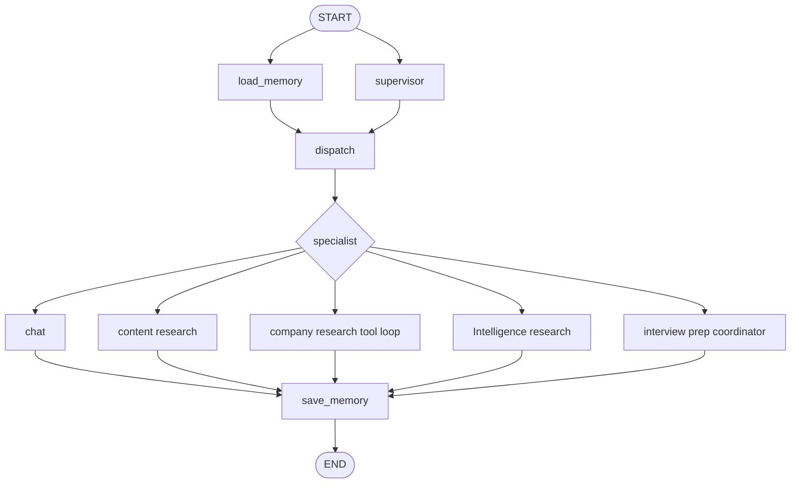

# Agent Service Flow

This document summarizes how the Python LangGraph service routes agent requests, shares state, uses memory and guardrails, runs the interview-prep agents in parallel, and streams progress to the frontend.

## 1. Request to Agent

There are two main request paths:

- **Synchronous chat:** `POST /api/chat` invokes the Python graph and waits for the final reply. `thread_id` selects the checkpointed conversation; `user_id` enables user-scoped long-term memory.
- **Background/SSE chat:** the Node gateway accepts `POST /api/agent/run`, creates a `runId`, and calls Python `POST /internal/agent/execute`. Python runs the graph in a background task and publishes progress to Redis. The frontend subscribes to `GET /api/agent/stream/:runId`.
- **Structured interview prep:** `POST /api/agent/interview-prep` accepts configured fields or a natural-language `message`. It returns a `runId` and `threadId`; results and clarification events use the same SSE endpoint. `POST /api/agent/interview-prep/resume` continues a paused graph on the same thread.

The Python entry points and graph are in `agents-service/src/main.py` and `agents-service/src/graph/builder.py`. Node gateway routes and SSE replay are in `backend/src/agent/routes.ts` and `backend/src/agent/controller.ts`.

## 2. Shared Graph Flow

`AgentState` in `agents-service/src/graph/state.py` is the graph's shared state contract. Important parts include:

- `messages`: conversation, appended by LangGraph's message reducer.
- `user_id`, `memory_context`: identity and memories for the current user/turn.
- `task_context`: structured profiles such as `company_profile`, `job_intelligence`, and `interview_prep`.
- `scratchpad`: temporary node/tool coordination data.
- `guardrail_flags`: guardrail results.
- `handoffs`, `execution_events`, and `researched_materials`: structured outputs and per-turn traces.
- `workflow_*` and `*_result` fields: interview-prep inputs, pause/resume state, and isolated branch results.

The supervisor and memory recall start together. `dispatch` waits for both before routing. Most simple specialists are registered in `agents/registry.py` and automatically wired to `save_memory`. Tool loops and multi-node workflows are wired explicitly in `graph/builder.py`.

## 3. Agents and Shared Capabilities

| Agent/node                                             | Main work                                                                                             | Memory usage                                                                                                                                               | Guardrails / data boundary                                                                                   |
| ------------------------------------------------------ | ----------------------------------------------------------------------------------------------------- | ---------------------------------------------------------------------------------------------------------------------------------------------------------- | ------------------------------------------------------------------------------------------------------------ |
| `chat` (`ChatAgent`)                                   | General PrepAmigo response                                                                            | Inherits `BaseAgent`; recalled facts and recent messages are added to its prompt                                                                           | No external search tools                                                                                     |
| `research` (`ResearchNode` + `ContentResearchAgent`)   | Learning resources, docs, books, papers, videos, transcripts                                          | Requires `user_id`; reuses `memory_context` during request extraction and research scoping                                                                 | Search tools validate inputs, bound results, sanitize links, and label mock/fixture sources                  |
| `company_research` (`CompanyResearchAgent`)            | Company facts, engineering context, and news                                                          | The outer graph still recalls/saves memory; the company agent's own prompt currently consumes its messages and task context, not `memory_context` directly | Its tool calls pass through `cr_guardrails` before `cr_tools`; tool errors are handled by `ToolNode`         |
| `interview_intelligence` (`InterviewIntelligenceNode`) | Company/role-specific interview rounds and candidate reports                                          | Request extraction can use recalled memory                                                                                                                 | Uses bounded search tools and reports source errors/coverage                                                 |
| `job_intelligence` (`JobIntelligenceAgent`)            | Job postings, skills, seniority, responsibilities, qualifications                                     | No direct Mem0 call; participates in the graph workflow and final exchange save                                                                            | Pydantic input/output validation, Mongo profile cache, bounded SerpApi/LLM calls, safe partial/error results |
| `interview_prep` (`InterviewPrepOrchestrator`)         | Collect required fields, run Company Research and Job Intelligence concurrently, evaluate and clarify | Field extraction may consult recalled memory; intermediate profiles stay in checkpoint/task context                                                        | Central field schema, isolated branch results, timeout/error handling, bounded clarification and evaluation  |

### Memory

Memory has two layers:

- **Short-term:** LangGraph's `MemorySaver` checkpoint, keyed by `thread_id`. It preserves messages and an interrupted workflow while the Python process is running. It is process-local and does not survive a restart.
- **Long-term:** `memory.nodes.load_memory` queries the configured provider for the authenticated `user_id`; `save_memory` asynchronously submits the latest user/assistant exchange. Providers are selected with `MEMORY_PROVIDER` (`local`, `mem0`, or `mem0_oss`). Mem0 initialization/search/save failures degrade to empty recall or a logged save failure rather than failing the agent response.

The shared memory nodes run for graph turns; recalled memory is only passed into prompts/nodes that explicitly read `memory_context`. Workflow scratch results are not independently written as durable facts.

### Guardrails

`guardrails/validators.py` currently checks for the tool names `charge_card` and `delete_reservation`, recording the outcome as `guardrail_flags.payment_check`. Company Research's tool loop runs this check before executing tools. Job Intelligence and the orchestrator additionally validate schemas and allowed workflow transitions.

This guardrail is intentionally narrow; it is not a general-purpose PII/content safety filter. Add domain-specific checks before wiring agents that perform sensitive or irreversible operations.

## 4. Configurable Interview-Prep Fields

`agents/interview_prep_fields.py` is the single source of truth for each workflow input:

| Field      | Required | Routed to                          |
| ---------- | -------: | ---------------------------------- |
| `company`  |      yes | Company Research, Job Intelligence |
| `role`     |      yes | Company Research, Job Intelligence |
| `location` |      yes | Job Intelligence                   |

Each `WorkflowField` also defines a user-facing label, description, and maximum length. This definition drives the extraction schema, missing-field detection, contextual clarification question, per-agent payload, and frontend form. The authenticated field-schema endpoint is `GET /api/agent/interview-prep/fields`.

The coordinator accepts either defined `fields` or free text. Its LLM extracts only explicit values into the configured field names. Unknown values remain empty; they are not guessed. If data is missing, it asks a contextual question, for example:

- Location supplied: “Which company and role are you targeting in Seattle?”
- Role and location supplied: “Do you have a specific company in mind for the SDE role in Seattle?”

The LangGraph `interrupt` pauses on that question. A reply is parsed through the same extractor, merged with prior values, and validated again. If complete, both agents run; otherwise the coordinator asks about the remaining fields. Clarification is bounded to three rounds.

To add a field, define it in `WORKFLOW_FIELDS` with its `required` flag, description, and `recipients`. Update a recipient agent if it needs custom handling for the new value. The frontend Chat and Defined Inputs modes both use the field schema.

## 5. Parallel Interview-Prep Execution

Once all required fields are available, the coordinator creates two branches and awaits them together with `asyncio.gather(..., return_exceptions=True)`:

1. **Company Research:** a branch-local LangGraph subgraph runs the Company Research tool-calling loop. Its messages and tool state are not shared with the other branch.
2. **Job Intelligence:** receives only fields whose configured recipients include `job_intelligence` and writes to `job_intelligence_result`.

The branches write to separate result fields, avoiding parallel writes to the shared message history or `task_context`. The join validates both results and merges profiles once. Each branch has a 45-second timeout. One branch can fail while the other result is retained.

A single bounded evaluator determines `complete`, `partial`, `failed`, or `clarify`. If it asks a genuine follow-up, the graph pauses and resumes through the same interrupt path. It does not autonomously retry either agent; the explicit user reply starts the needed execution again. Evaluator failure uses deterministic result statuses.

## 6. SSE: Progress and Resume

The background streaming path works as follows:

1. The Node gateway creates a `runId` and asks Python to execute the graph with a `thread_id`.
2. `streaming.runner.execute_agent_stream` runs `graph.astream` through `graph/streaming.stream_turn`.
3. `stream_turn` observes graph updates and custom agent events. `langgraph_bridge.bridge_graph_turn` maps them to the shared event types.
4. `EventPublisher` writes each event to Redis Pub/Sub channel `agent:events:{runId}` and a replay list `agent:history:{runId}`.
5. The Node SSE endpoint relays live events, replays missed history on reconnect, and sends heartbeats.

Common event types are `thinking`, `calling_agent`, `researching`, `processing`, and `structuring`. `waiting` includes the coordinator's actual clarification question and closes that run's stream. The frontend sends the reply to the resume endpoint with the same `threadId` and a new `runId`. `completed` contains the final status and both branch results; `failed` carries a safe client-facing detail.

Redis history is retained for one hour by default. The Node stream sends 15-second heartbeat events and has a 90-second inactivity timeout. `STREAM_RESPONSES` controls token streaming for direct graph streams; the Redis/SSE bridge is step/event-based rather than token-by-token.

## 7. Cost and Behavior Switches

| Setting                  | `true` / enabled                                                         | `false` / disabled                                        | Cost/behavior effect                                                                                                                         |
| ------------------------ | ------------------------------------------------------------------------ | --------------------------------------------------------- | -------------------------------------------------------------------------------------------------------------------------------------------- |
| `SERPAPI_ENABLED`        | Calls live SerpApi; requires `SERPAPI_API_KEY`                           | Reads provider-shaped JSON from `SERPAPI_DUMMY_DATA_PATH` | Prevents SerpApi requests/credits across the Python agents using the shared client                                                           |
| `USE_DUMMY_STREAM`       | Emits the scripted SSE demonstration instead of the ordinary real graph  | Runs the real graph                                       | Saves LLM/search work for demo stream requests. The structured interview-prep workflow forces the real graph so the coordinator is exercised |
| `RESEARCH_CACHE_ENABLED` | Enables file cache for eligible Content/Interview research SerpApi calls | Bypasses that cache                                       | Cache hits avoid repeat live requests; `RESEARCH_CACHE_TTL_SECONDS` controls expiry (`0` means no expiry)                                    |
| `STREAM_RESPONSES`       | Enables token-level streaming where supported                            | Disables token streaming                                  | Affects response streaming, not which provider or agent runs                                                                                 |
| `LLM_PROVIDER`           | Selects the primary Python model provider; currently `ollama`            | N/A                                                       | Affects model/provider cost; fixture mode still uses the LLM for extraction/synthesis                                                        |

`SERPAPI_DUMMY_DATA_PATH` defaults to `.data/serpapi_fixtures.json` relative to `agents-service/`. Example fixtures live in `agents-service/docs/serpapi_fixtures.example.json` and `agents-service/docs/serpapi_fixtures.pipeline.json`. Fixture results are labeled as dummy and should not be treated as live evidence. Disabling SerpApi does **not** disable LLM calls. Content Research may still fetch YouTube transcripts through `youtube-transcript-api`; that is separate from SerpApi. Job Intelligence also uses the MongoDB `job_intelligence_profiles` cache independently of the Content Research file cache.

The fixture file accepts either a top-level engine map or `{ "engines": { ... } }`, with optional `default` and `by_query` entries per engine. `USE_DUMMY_STREAM` and `SERPAPI_ENABLED` are separate controls: the first switches the execution path, while the second switches the Python search provider.

## 8. Main Implementation Map

- Graph/state/routing: `agents-service/src/graph/builder.py`, `state.py`, `router.py`
- Agent registry and supervisor: `agents-service/src/agents/registry.py`, `supervisor.py`
- Interview-prep field schema and coordinator: `agents-service/src/agents/interview_prep_fields.py`, `interview_prep_orchestrator.py`
- Memory and provider selection: `agents-service/src/memory/nodes.py`, `store.py`
- Guardrail: `agents-service/src/guardrails/validators.py`
- Search fixture boundary: `agents-service/src/tools/serpapi_client.py`
- SSE runner/bridge/publisher: `agents-service/src/streaming/runner.py`, `agents-service/src/graph/streaming.py`, `agents-service/src/streaming/langgraph_bridge.py`, `agents-service/src/streaming/publisher.py`
- Node gateway and frontend: `backend/src/agent/controller.ts`, `frontend/src/pages/InterviewPrep.tsx`
