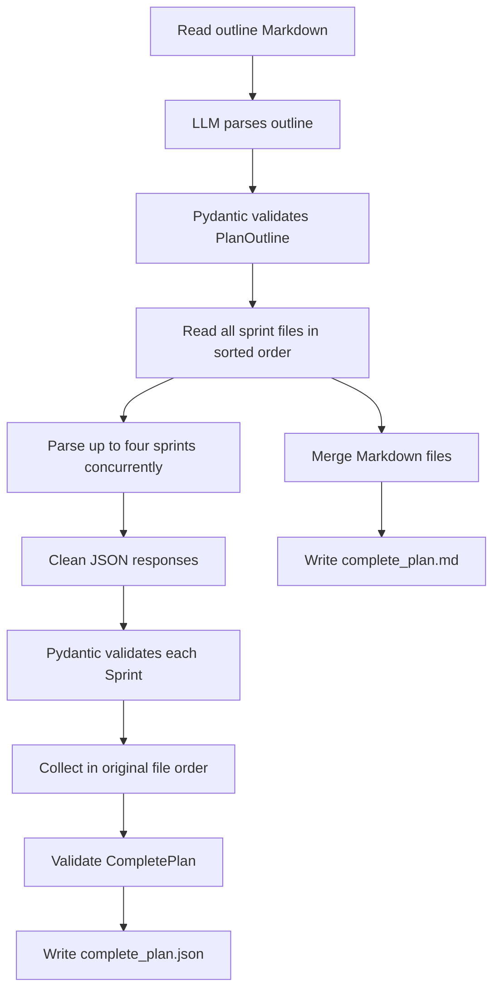

# Markdown Plan Parser Agent

This guide explains how the Python parser turns the Markdown plan files into a validated nested JSON payload and a merged Markdown document. The parser is in `agents-service/src/scripts/parser_agent.py`; it does not call the Node backend or write to MongoDB.

## Inputs and outputs

The parser reads:

- `agents-service/.data/dummy_md/00_outline.md` for plan metadata and date context.
- `agents-service/.data/dummy_md/NN_sprint_*.md` for sprint schedules. Files are sorted by name before parsing.

It writes:

- `agents-service/.data/output/complete_plan.json`: the Pydantic-validated nested plan payload.
- `agents-service/.data/output/complete_plan.md`: the outline and sprint Markdown combined in order, separated by horizontal rules. Sprint headings are shifted down one heading level to preserve document hierarchy.

## Processing flow



The outline is parsed first because its dates supply the year for sprint dates that only specify a month and day. Sprint parsing is independent after that. `ThreadPoolExecutor` runs up to four sprint LLM calls concurrently; its ordered map keeps the final sprint array in sorted file order. If a sprint response fails JSON parsing or Pydantic validation, the run stops rather than writing a partially validated plan.

## Schema mapping

The Pydantic models follow the Mongoose fields in `agents-service/.data/scratch/schemas.txt`:

- Plan metadata maps to `company`, `role`, `total_days`, `start_date`, and `end_date`. The parser also creates `plan_name`, `user_id`, `completion_percent`, and `status`.
- Sprint entries map to `sprint_number`, `sprint_name`, `start_date`, `end_date`, and `total_days`.
- Daily entries are represented as `sprint_days`, with `scheduled_date`, `topic_title`, `topic_description`, `objectives`, `estimated_minutes`, and `references`.
- Reference entries contain `type`, `title`, `url`, `source`, `description`, and `is_required`. `type` is limited to `video`, `article`, `documentation`, `problem`, `course`, or `book`.
- Status fields use `pending`, `in_progress`, or `completed`; new records default to `pending` and `completion_percent` defaults to `0`.

Models reject unexpected fields. Objectives must be strings, `is_required` must be a boolean, and `user_id` must have the 24-hex-character shape of a MongoDB ObjectId.

## MongoDB references and API expectations

The Mongoose schema stores Plan-to-Sprint, Sprint-to-SprintDay, and SprintDay-to-Reference relationships as ObjectId references. This parser currently emits the selected **nested creation payload** so all schedule data is present in one JSON document. The future backend endpoint must create the child documents, set their required parent IDs, and replace nested child values with ObjectId references before saving the Plan. Passing this payload directly to `Plan.create()` will not create the referenced records.

When `PLAN_USER_ID` is unset, the parser uses `000000000000000000000001` as a test placeholder and logs a warning. That ID is syntactically valid but does not imply a real user exists. Set `PLAN_USER_ID` to an existing user's ID before sending the payload to the backend.

## Configure the LLM

The parser calls the agent service's existing `get_llm()` helper, which reads `agents-service/.env` through `python-dotenv`.

For the current Ollama Cloud setup, the configuration has this shape:

```dotenv
LLM_PROVIDER=ollama
OLLAMA_MODEL=your-ollama-model
OLLAMA_BASE_URL=http://localhost:11434
```

`localhost:11434` is the Ollama client endpoint. A model name ending in `-cloud` routes inference to Ollama Cloud; a locally installed model runs inference on the local machine. The Python service currently uses Ollama as its primary provider. An optional OpenAI-compatible endpoint can be configured with `FAST_LLM_BASE_URL`, `FAST_LLM_MODEL`, and `FAST_LLM_API_KEY` for calls explicitly assigned to the fast model profile.

## Run the parser

From Command Prompt in the `agents-service` directory, with its virtual environment active and configured LLM reachable:

```cmd
python src/scripts/parser_agent.py
```

Install dependencies into that same environment if needed:

```cmd
python -m pip install -r requirements.txt
```

The script makes one LLM call for the outline and one per sprint file. Sprint calls run in parallel with a maximum concurrency of four. Generation time depends on the model/provider, network, prompt size, and any provider-side queuing or rate limits.

## Verify the output

Check that the JSON is syntactically valid:

```cmd
python -m json.tool output\complete_plan.json
```

To count the daily entries in the generated plan:

```cmd
python -c "import json; p=json.load(open('output/complete_plan.json', encoding='utf-8')); print(sum(len(s['sprint_days']) for s in p['sprints']))"
```

For the supplied 45-day sample schedule, the count should be `45`. A successful run logs both output paths. A Pydantic validation error or LLM/JSON parsing error stops generation and is shown in the terminal.
