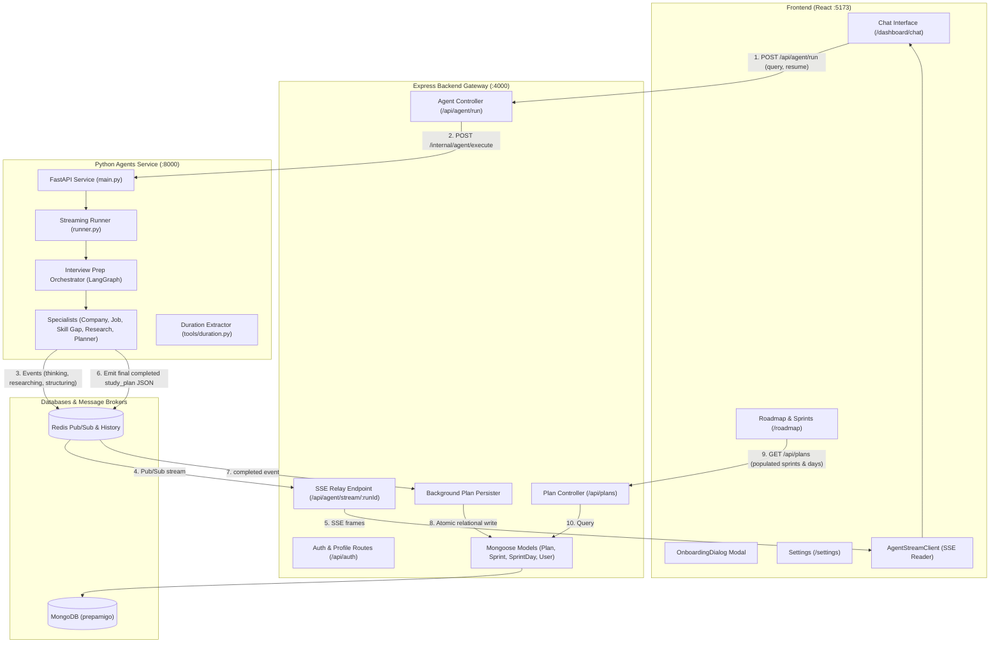

# PrepAmigo End-to-End Integration Changes Reference

> **Document Version:** 1.0.0  
> **Date:** October 6, 2026  
> **Branch:** `rijhan-integration`  
> **Status:** Completed & Verified  

---

## 1. Executive Summary

This document provides an exhaustive, authoritative record of all architectural changes, additions, schema migrations, bug fixes, and file removals performed during the end-to-end integration of **PrepAmigo**:

1. **Frontend (React 19 + Vite + Tailwind CSS)**: Completely replaced hardcoded mock datasets with live API integrations, centralized authentication state, implemented first-time candidate onboarding, streamlined chat-to-roadmap redirection, and eliminated obsolete prototype routes.
2. **Backend Gateway (Node.js + Express + TypeScript + Mongoose)**: Decoupled database operations from the Python agent runtime, resolved sprint-to-day relational persistence bugs, introduced in-flight concurrency locks, added profile management endpoints, and automated candidate resume auto-ingestion.
3. **Agent Service (Python 3.11 + FastAPI + LangGraph)**: Stripped out direct MongoDB dependencies to achieve a 100% stateless architecture, resolved the hardcoded 45-day duration constraint with dynamic natural-language extraction, and ensured full end-to-end SSE telemetry over Redis.

---

## 2. End-to-End Architecture & Data Flow



---

## 3. Database & Persistence Layer Changes

### 3.1. Decoupled Database Architecture
- **Problem**: Previously, `agents-service` attempted to write directly to MongoDB via `plan_db_sync.py` and maintained internal collections for `JobIntelligenceAgent`, creating cross-service database coupling, port collisions, and 401 unauthenticated sync failures.
- **Solution**: The **Express backend is now the sole owner of MongoDB**. All MongoDB connectivity, caching, and document models were removed from `agents-service`. The agents service emits structured JSON over Redis SSE, and the backend gateway persists the entities with the authenticated `userId`.

### 3.2. Sprint Day Duplication Bug Fix
- **Problem**: In the roadmap frontend, each sprint was displaying the entire 45-day plan instead of its designated days, resulting in $7 \times 45 = 315$ duplicate days.
- **Root Cause**: In `backend/src/agent/controller.ts`, sprint day matching evaluated:
  ```ts
  rawAllDays.filter((d) => d.sprint_number === s.sprint_number || d.sprint_id === s._id)
  ```
  Because neither `d.sprint_id` nor `s._id` existed on raw unpersisted JSON, `undefined === undefined` evaluated to `true`, pushing all days into every single sprint.
- **Fix**: Replaced with strict numerical sprint matching:
  ```ts
  const sprintDaysList = Array.isArray(s.sprint_days) && s.sprint_days.length > 0
    ? s.sprint_days
    : rawDays.filter((d: any) => d && Number(d.sprint_number) === sprintNumber);
  ```
  Days are strictly partitioned: Sprints 1–3 receive 7 days each, and Sprints 4–7 receive 6 days each (summing up to exactly 45 days, or 13 sprints for a 90-day plan).

### 3.3. In-Flight Save Lock & Idempotency
- Added `savingRunPlanMap` in `backend/src/agent/controller.ts`:
  ```ts
  const savingRunPlanMap = new Map<string, Promise<string | null>>();
  ```
  Prevents duplicate plan documents when Redis history replay and live pub/sub messages trigger `persistGeneratedPlan` concurrently.

### 3.4. Schema Enhancements
- **[`backend/src/models/User.ts`](file:///C:/project/PrepAmigo-Multi-Agent-Personalized-Preparation-System/backend/src/models/User.ts)**:
  - Added `resume_filename: { type: String, default: null }`
  - Added `resume_text: { type: String, default: null }` to `profile` subdocument.
- **Normalized Resource References**: Inlined `normalizeReferenceType` to map agent resource types (`paper` $\rightarrow$ `article`, `video` $\rightarrow$ `video`, `book` $\rightarrow$ `book`, `documentation` $\rightarrow$ `documentation`) directly onto the `Reference` Mongoose subdocument schema.

### 3.5. Redis Real SSE Streaming vs Dummy Stream Replacement
- **Background & Problem**: During early UI prototyping, streaming relied on simulated/dummy generators (`USE_DUMMY_STREAM=true`) or mocked SSE strings. This masked synchronization errors, reconnection failures, and prevented real agent telemetry from reflecting live LangGraph state transitions.
- **Production Architecture**:
  1. **LangGraph Custom Event Interception**: `agents-service/src/streaming/runner.py` executes `bridge_graph_turn()`, capturing real-time LangGraph node events across all specialist agents (`Supervisor`, `Company Research`, `Job Intelligence`, `Skill Gap`, `Research Agent`, `Planner Agent`).
  2. **Redis Pub/Sub & History Cache**:
     - **Channel**: `agent:events:{runId}` broadcasts live event payloads as JSON strings.
     - **History List**: `agent:history:{runId}` stores an append-only array of all emitted events with a 3600s (1 hour) TTL via `RPUSH`.
  3. **Express Gateway SSE Relay (`GET /api/agent/stream/:runId`)**:
     - **Event Replay**: Upon initial connection or reconnect (reading `Last-Event-ID` header or `?lastEventId=` query parameter), the backend queries `LRANGE agent:history:{runId} 0 -1` and immediately flushes missed events before subscribing to live channels.
     - **Multiplexed Pub/Sub**: If the run is ongoing, the gateway attaches a dedicated Redis subscriber to `agent:events:{runId}` and relays live events.
     - **15s Keep-Alive Heartbeat**: Background `setInterval` emits `{ type: "ping", payload: { heartbeat: true } }` every 15 seconds to prevent browser and reverse-proxy connection timeouts.
     - **90s Inactivity Watchdog**: A watchdog timer resets on every inbound domain event. If no events arrive for 90 seconds (covering worst-case LLM generation latency), it dispatches a `{ type: "failed" }` event and cleans up resources.
     - **Clean Resource Teardown**: Upon client disconnect (`req.on("close")`, `res.on("close")`), the backend unsubscribes from Redis, quits the Redis subscriber, and clears all timers.
  4. **Dual-Trigger Background Plan Persistence**:
     - When the terminal `completed` event containing `study_plan` JSON is emitted, plan persistence is triggered via two redundant, non-blocking paths:
       - **Inline in SSE stream**: In `streamAgentHandler`, the plan is persisted and the new `plan_id` is stamped onto the completion event payload.
       - **Detached Background Listener**: `listenAndPersistPlanInBackground(runId, userId)` runs independently in the backend process, guaranteeing the plan is saved even if the user closes their browser tab before the stream completes.
     - The `savingRunPlanMap` lock ensures strictly idempotent, single-execution persistence between both triggers.

---

## 4. Authentication, Session & Candidate Onboarding

### 4.1. Centralized Auth Context
- **Problem**: Auth state was duplicated across multiple hook instances (`useAuth.ts`), causing login state to fall out of sync after signup, preventing onboarding dialogs from opening.
- **Solution**: Created a single-instance React Context provider in [`frontend/src/hooks/useAuth.ts`](file:///C:/project/PrepAmigo-Multi-Agent-Personalized-Preparation-System/frontend/src/hooks/useAuth.ts):
  - Exposes `user`, `loading`, `setUser`, `updateProfile`, `logout`, and `refreshUser`.
  - Wrapped around the entire component tree in [`frontend/src/App.tsx`](file:///C:/project/PrepAmigo-Multi-Agent-Personalized-Preparation-System/frontend/src/App.tsx).

### 4.2. Clean Public Landing Visits
- Modified `GET /api/auth/me` in [`backend/src/auth/routes.ts`](file:///C:/project/PrepAmigo-Multi-Agent-Personalized-Preparation-System/backend/src/auth/routes.ts):
  - Returns HTTP 200 `{ user: null }` when no JWT session cookie is present, eliminating browser console 401 error alerts on public routes (`/`, `/login`, `/signup`).

### 4.3. Profile Persistence Endpoint
- Added `PUT /api/auth/profile` in `backend/src/auth/routes.ts`:
  - Accepts `target_role`, `experience_level`, `target_companies`, `skills`, `github_url`, `resume_filename`, and `resume_text`.
  - Atomically updates and returns the refreshed `User` object.

### 4.4. First-Time Candidate Onboarding
- **[`frontend/src/components/auth/OnboardingDialog.tsx`](file:///C:/project/PrepAmigo-Multi-Agent-Personalized-Preparation-System/frontend/src/components/auth/OnboardingDialog.tsx)** (New):
  - Full modal with role suggestion badges, experience level selector (`Student`, `Fresher`, `Experienced`), technical skills tags, and drag-and-drop resume upload with text parsing.
- **[`frontend/src/components/layout/AppLayout.tsx`](file:///C:/project/PrepAmigo-Multi-Agent-Personalized-Preparation-System/frontend/src/components/layout/AppLayout.tsx)**:
  - Scopes skip keys per user (`prepamigo_onboarding_skipped_${user.id || user.sub}`).
  - Automatically launches `OnboardingDialog` on login/signup if `!user.profile?.target_role`.
- **[`frontend/src/pages/Auth.tsx`](file:///C:/project/PrepAmigo-Multi-Agent-Personalized-Preparation-System/frontend/src/pages/Auth.tsx)**:
  - Immediately calls `setUser(data.user)` on email signup/login and Google Auth, enabling instant session activation without page reload.

### 4.5. Frontend Route Protection & Cross-Service Auth Passing
- **Route Protection Architecture**:
  - All application dashboard and roadmap routes (`/dashboard/*`, `/roadmap`, `/calendar`, `/assessment`, `/resource-pack/*`) are nested under `AppLayout`.
  - `AppLayout` enforces authentication when `featureFlags.enableAuth` (`VITE_ENABLE_AUTH`) is active:
    - Displays a non-blocking loading spinner while the session hydrates.
    - Automatically redirects unauthenticated guests to `/login` via `<Navigate to="/login" state={{ from: location }} replace />`.
- **Landing Page & Chat Query Interception Buffer**:
  - In [`frontend/src/pages/Home.tsx`](file:///C:/project/PrepAmigo-Multi-Agent-Personalized-Preparation-System/frontend/src/pages/Home.tsx), if an unauthenticated visitor enters a query into the hero chat input, the system buffers the prompt to `sessionStorage.setItem("prepamigo_pending_query", trimmed)` and redirects to `/login`.
  - Upon successful authentication or signup, the user is navigated to `/dashboard/chat`.
  - [`frontend/src/pages/Chat.tsx`](file:///C:/project/PrepAmigo-Multi-Agent-Personalized-Preparation-System/frontend/src/pages/Chat.tsx) reads the buffered query from `sessionStorage`, removes the session key, and auto-submits the prompt to initiate roadmap generation seamlessly.
- **API Request Authentication & Token Propagation**:
  - Every backend endpoint under `/api/plans/*`, `/api/sprints/*`, `/api/sprint-days/*`, `/api/progress/*`, and `/api/agent/*` is guarded with `requireAuth` middleware.
  - When the backend invokes the Python agent service via `/internal/agent/execute` or `/internal/agent/extract-resume`, `pythonAuthHeaders(req)` extracts the active session token (or signs a cryptographically verified JWT bearer token with `JWT_SECRET`) and forwards it in the `Authorization: Bearer <token>` header, securing the Python service endpoints against unauthorized calls.

---

## 5. Chat, Dynamic Durations & Roadmap Navigation

### 5.1. Dynamic Plan Duration Fix (90-Day vs 45-Day Resolution)
- **Problem**: When users requested plans of custom lengths (e.g., *"I have 90 days to prepare for Backend Engineer at Stripe"*), the system generated 45 days every time.
- **Root Cause**:
  1. `agents-service/src/agents/interview_prep_orchestrator.py` evaluated:
     `total_days = state.get("plan_total_days") or settings.plan_total_days`
     where `settings.plan_total_days` is 45.
  2. The LLM extraction schema in `interview_prep_fields.py` only recognized `company`, `role`, and `location`.
  3. The backend gateway did not extract or pass `plan_days` in the execute payload.
- **Solution**:
  - **[`agents-service/src/tools/duration.py`](file:///C:/project/PrepAmigo-Multi-Agent-Personalized-Preparation-System/agents-service/src/tools/duration.py)** (New):
    - `extract_duration_days(text)`: Parses days (`90 days`, `90-day`), months (`3 months` $\rightarrow 90$), and weeks (`6 weeks` $\rightarrow 42$) within bounds $[1, 365]$.
    - `resolve_plan_total_days(state, candidate_texts)`: Evaluates state, inputs, query, and recent conversation messages.
  - **[`agents-service/src/streaming/runner.py`](file:///C:/project/PrepAmigo-Multi-Agent-Personalized-Preparation-System/agents-service/src/streaming/runner.py)**: Resolves `plan_days` from `query` or `workflow_text_input` and injects `inputs["plan_total_days"]`.
  - **[`agents-service/src/agents/interview_prep_orchestrator.py`](file:///C:/project/PrepAmigo-Multi-Agent-Personalized-Preparation-System/agents-service/src/agents/interview_prep_orchestrator.py)**:
    - `_prepare`: Retains `plan_total_days` across turns and clarification pauses.
    - `_run_planner`: Passes resolved `total_days` directly to `PlannerAgent.build_plan()`.
  - **[`backend/src/agent/controller.ts`](file:///C:/project/PrepAmigo-Multi-Agent-Personalized-Preparation-System/backend/src/agent/controller.ts)**:
    - Added `extractPlanDays(query)` and passes `plan_days` in payloads to `/internal/agent/execute` in both `runAgentHandler` and `triggerInterviewPrep`.

### 5.2. Profile Resume Auto-Ingestion
- In `backend/src/agent/controller.ts`, if the user has not explicitly attached a file in chat, the backend checks `User.findById(userId).select("profile.resume_text")` and automatically forwards the candidate's stored resume to the agent service.

### 5.3. Streamlined Chat Redirection
- **[`frontend/src/components/chat/Messages.tsx`](file:///C:/project/PrepAmigo-Multi-Agent-Personalized-Preparation-System/frontend/src/components/chat/Messages.tsx)**:
  - Replaced bulky mock cards with a compact completion redirect card:
    ```
    [✓ {Role} at {Company} plan ready!] [Go to Roadmap ->] [Calendar]
    ```
- **[`frontend/src/pages/Chat.tsx`](file:///C:/project/PrepAmigo-Multi-Agent-Personalized-Preparation-System/frontend/src/pages/Chat.tsx)**:
  - Added header bar with a live pulsing agent indicator and a **"New Plan"** reset button.

### 5.4. Removal of Obsolete Prototype Pages
- Completely deleted legacy unused routes and components:
  - `frontend/src/pages/Preps.tsx`
  - `frontend/src/pages/PrepDetails.tsx`
  - `frontend/src/components/preps/PrepCard.tsx`
  - `frontend/src/components/preps/PrepOverview.tsx`
  - `frontend/src/components/preps/SkillGapMap.tsx`
  - `frontend/src/components/preps/AffectedTopics.tsx`
- Unified all navigation exclusively to [`frontend/src/pages/Roadmap.tsx`](file:///C:/project/PrepAmigo-Multi-Agent-Personalized-Preparation-System/frontend/src/pages/Roadmap.tsx), which now includes a **Multi-Plan Switcher** pill bar for users with multiple active preparation roadmaps.

---

## 6. Complete File-by-File Change Matrix

| Action | File Path | Description of Changes |
| :--- | :--- | :--- |
| **ADDED** | `agents-service/src/tools/duration.py` | Duration parsing (`extract_duration_days`, `resolve_plan_total_days`) for custom day counts. |
| **ADDED** | `agents-service/tests/test_duration.py` | Unit tests for duration extraction, bounds checking, and message resolution. |
| **ADDED** | `frontend/src/components/auth/OnboardingDialog.tsx` | Modern first-time candidate setup modal with role suggestions and resume parser. |
| **ADDED** | `.superpowers/plans/*` | Relocated all architecture plans and specifications into root `.superpowers/plans/`. |
| **MODIFIED** | `agents-service/src/agents/interview_prep_orchestrator.py` | Dynamic `plan_total_days` propagation in `_prepare` and `_run_planner`. |
| **MODIFIED** | `agents-service/src/streaming/runner.py` | Query-level duration fallback populating `inputs["plan_total_days"]`. |
| **MODIFIED** | `agents-service/src/tools/plan_builder.py` | Clean partitioning of arbitrary days into sprints (e.g. 90 days into 13 sprints). |
| **MODIFIED** | `agents-service/tests/test_planner_agent.py` | Added `test_ninety_day_plan_generation_allocates_correct_days_and_sprints`. |
| **MODIFIED** | `backend/src/agent/controller.ts` | Sprint day numerical partitioning, `savingRunPlanMap` lock, `extractPlanDays`, profile resume auto-ingestion. |
| **MODIFIED** | `backend/src/auth/routes.ts` | `GET /api/auth/me` returns 200 `{ user: null }` for guests; added `PUT /api/auth/profile`. |
| **MODIFIED** | `backend/src/models/User.ts` | Added `resume_filename` and `resume_text` fields to profile schema. |
| **MODIFIED** | `frontend/src/App.tsx` | Wrapped app tree in `AuthProvider`; removed deleted routes `/dashboard/preps` and `/dashboard/preps/:prepId`. |
| **MODIFIED** | `frontend/src/hooks/useAuth.ts` | Centralized `AuthProvider` context and exposed reactive authentication helpers. |
| **MODIFIED** | `frontend/src/pages/Auth.tsx` | Instant session hydration via `setUser` on email and Google auth. |
| **MODIFIED** | `frontend/src/components/layout/AppLayout.tsx` | Scoped onboarding skip keys; auto-triggers onboarding modal for new users. |
| **MODIFIED** | `frontend/src/components/chat/Messages.tsx` | Streamlined post-generation UI to compact Roadmap redirect card. |
| **MODIFIED** | `frontend/src/pages/Chat.tsx` | Added top header bar with agent activity badge and "New Plan" button. |
| **MODIFIED** | `frontend/src/pages/Roadmap.tsx` | Added multi-prep switcher pills; live API rendering of sprints, days, and references. |
| **MODIFIED** | `frontend/src/pages/AppHome.tsx` | Updated quick links and cards to point directly to `/roadmap`. |
| **MODIFIED** | `frontend/src/pages/Calendar.tsx` | Switched to live backend plan days; empty-state CTA to Chat. |
| **MODIFIED** | `frontend/src/pages/LevelDetail.tsx` | Live rendering of sprint day objectives, videos, articles, and book companions. |
| **MODIFIED** | `frontend/src/pages/Settings.tsx` | Live binding to `user.profile` with resume upload and profile updates. |
| **DELETED** | `frontend/src/pages/Preps.tsx` | Removed legacy mock preps listing page. |
| **DELETED** | `frontend/src/pages/PrepDetails.tsx` | Removed legacy mock prep details page. |
| **DELETED** | `frontend/src/components/preps/PrepCard.tsx` | Removed unused prep card component. |
| **DELETED** | `frontend/src/components/preps/PrepOverview.tsx` | Removed unused prep overview component. |
| **DELETED** | `frontend/src/components/preps/SkillGapMap.tsx` | Removed unused skill gap map component. |
| **DELETED** | `frontend/src/components/preps/AffectedTopics.tsx` | Removed unused affected topics component. |
| **DELETED** | `docs/superpowers/` | Removed redundant docs folder after migrating to root `.superpowers/`. |

---

## 7. Verification Results

All automated test suites and production build checks pass cleanly:

1. **Python Agents Service**:
   ```bash
   python -m pytest agents-service/tests
   ```
   - **Result**: `417 passed in 13.71s (100% PASS)`
2. **Express Backend Compilation**:
   ```bash
   npm run build # in backend/
   ```
   - **Result**: `0 errors (clean tsc compile)`
3. **React Frontend Production Build**:
   ```bash
   npm run build # in frontend/
   ```
   - **Result**: `0 errors (510 modules transformed, clean vite build)`
